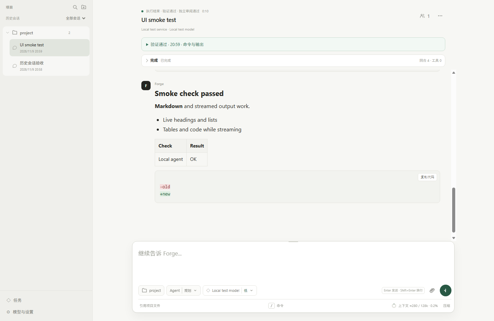

# Forge Agent

**Code locally, with inspectable changes, verification and interruption recovery.**

[Simplified Chinese](README.md) · English

[](https://github.com/sun-sh/forge-agent/actions/workflows/ci.yml)
[](LICENSE)

Forge is a local coding agent with a Web workspace. Connect a model you configure, open a project, and chat, edit files, run tools and inspect Git changes.

Forge is built on **Pi Coding Agent 1.4.0**, which owns model and tool turns. Forge's focus is the host layer around a local coding task: durable task state and recovery, evidence-based verification/protection, and a Web workspace for inspecting the work. It does not implement a second model/tool loop.



*Actual Edge acceptance screenshot using an isolated local fixture service, with the temporary path header removed. It demonstrates the UI, not model coding quality. [30-second screenshot walkthrough](docs/assets/walkthrough.gif).*

## Start locally

Prepare Git, Node.js **>= 22.19.0**, and an available model service:

```bash
git clone https://github.com/sun-sh/forge-agent.git
cd forge-agent
npm ci
npm run build
npm start
```

Startup opens the default browser. The default local address is `http://127.0.0.1:4317/`.

1. Open **Settings → Services → Add service** (`设置 → 服务 → 添加服务`). Enter the protocol, Base URL and key, fetch and select models or enter an ID, test and save. Keyless local services can be explicitly configured.
2. Choose a model, reasoning effort and **Agent / Plan / Ask** under the composer. Agent defaults to adaptive execution; only the secondary “Plan and execute” choice enables staged orchestration.
3. Open a project or send the first message to create a managed project folder. The paperclip, drag-and-drop and pasted images supply attachments.

The editor supports OpenAI Chat Completions, Responses and Anthropic Messages interfaces. The current Web UI is Chinese. See the [user guide](docs/usage.en.md) for setup and protocol boundaries. Pi supplies the optional terminal client; run `npm link` from source to use `forge-agent`.

## Documentation

| Goal | Start here |
| --- | --- |
| Install, configure and use Forge | [English guide](docs/usage.en.md) · [中文指南](docs/usage.md) |
| Understand architecture and security | [Architecture map (English)](docs/architecture.md) · [Architecture Deep Dive (Chinese)](docs/architecture-deep-dive.md) · [Security (English)](SECURITY.md) · [Local security guide (Chinese)](docs/usage.md#本机数据与安全) |
| Configure verification and recovery | [Task results (bilingual)](docs/task-results.md#english) · [Operations (bilingual)](docs/operations.md#english) |
| Read evaluation findings and the full catalog | [Evaluation overview](docs/evaluation.md#english-overview) · [All docs and historical reports](docs/README.md) |

## Project focus and source layout

The Agent engineering work lives in the host controls above Pi, not in model inference or a custom runtime:

| Path | Responsibility |
| --- | --- |
| `src/pi-cli.ts` | CLI entry; wires Pi TUI, identity and verification extension |
| `src/web/server.ts`, `src/web/` | Local Web gateway/API, project/session/provider adapters and execution lifecycle |
| `src/web/ui/` | Browser client: chat, history, settings, workspace and task progress |
| `src/task/` | Host task state, orchestration, queue, budgets, persistence, checkpoints and child tasks |
| `src/verification/` | Configured checks, protected paths and current-workspace evidence gates |
| `src/tools/command.ts` | Bounded command executor shared by verification and local terminal actions |
| Pi Coding Agent SDK | Model/tool turns, providers, sessions, compaction, MCP, Skills and resource discovery |

See [architecture overview](docs/architecture.md) for component relationships and the Chinese [Architecture Deep Dive](docs/architecture-deep-dive.md) for state, permission and recovery tradeoffs.

## Core behavior

| Need | Forge behavior |
| --- | --- |
| **Check delivery** | Verification binds to workspace and configuration fingerprints. Changed protected files fail delivery even when tests pass. Historical passes remain distinct from current evidence. |
| **Opt into planning** | Inspection returns a concise plan in the same handoff; a separate planning call is a fallback. Implementation, verification and independent review preserve requirements; bounded historical command receipts inform review, and repair reviews focus on prior findings. Model interpretations do not add user authority. |
| **Continue interrupted work** | Reuse the Pi conversation and files at a valid saved phase, without appending the original request or replaying tools. Interrupted verify/review begins with fresh verification. |
| **Make delivery files visible** | The task lists file-tool writes/edits observed by Forge and opens them in the viewer. Shell-created files are not guaranteed to appear in that list; browse them in the right-side Files panel. |
| **Keep the UI focused** | Project-based conversations and forks, right-aligned user messages and folded process output. Changes, files, terminal and execution records live on the right; pause reasons appear beside the composer. |
| **Keep conversations independent** | Switch chats or start a new one while a task runs in the background. Model, effort and mode choices stay with each chat and take effect on its next message. On request, search and read bounded references from other conversations in the same project, without automatically merging history. |
| **Bound parallel work** | Queue up to three different projects. Subagents explore/review with readers; workers propose changes in isolated worktrees for user-reviewed application and main-project verification. |

Planned execution and independent review are explicit experimental choices; adaptive remains the default. Reviewer standard limits are 5 minutes, 24 turns, 120 tools, 32,000 output tokens and a configured $4 limit; extended limits are opt-in. Budget exhaustion, missing evidence and concrete findings have separate outcomes. Model review is not external acceptance. See [review outcomes](docs/review-outcomes.md) and the [evaluation index](docs/evaluation.md#english-overview).

Public web search and URL text reading work out of the box without a search API key. **Settings → Tools** provides an opt-out and an actual document-connection test. Results retain source URLs; use browser MCP for interactive or authenticated pages. The UI manages models, MCP, Skills, context compaction and scoped reference memory. Ordinary workers have no shell, MCP or nested delegation and suit bounded file tasks. See [subagent design](docs/subagents.md) for permissions, budgets and proposal limits.

When verification is configured, Planned designs and runs frozen checks before implementation, preserves the baseline, then verifies and reviews. Check design, environments and model judgments can still fail. The fixed-patch experiments did not establish general reviewer detection gains; native-boundary efficacy remains unqualified. Detailed protocols and failures are in the [documentation catalog](docs/README.md).

## Configure verification and protected paths

Create `forge-agent.json` in the target project root; YAML is also supported:

```json
{
  "verify": [
    { "name": "typecheck", "command": "npm run typecheck", "timeoutMs": 120000 },
    { "name": "test", "command": "npm test", "timeoutMs": 300000 }
  ],
  "verifyRetries": 2,
  "protect": ["tests", "package-lock.json"]
}
```

Only `verify`, `verifyRetries` and `protect` are accepted; unknown fields fail. Commands require project trust. Exact failure output returns to the model and cannot produce a successful exit. `protect` accepts literal project-relative files/directories; pre-existing dirty content becomes the baseline, and changes or incomplete observations block delivery. See the [schema](forge-agent.schema.json) and [user guide](docs/usage.en.md).

Implementation finishes as **implemented · unverified** (API: `result.status=implemented_unverified`). Configured checks and model review are separate evidence, neither certifying resolution. Stale checks require inspection; unverified acceptance alone does not rerun tasks. See [execution versus acceptance semantics](docs/task-results.md) for API compatibility and unchanged quality metrics.

Missing checks never imply verified success. A completed implementation without configured checks is shown as “implemented · unverified · checks not configured,” with its written files listed. A model-initiated run_verification and the host check share the same skipped state; an empty report cannot leave the task waiting for verification. Planned implementation still requires current evidence when verification commands are configured; read-only Plan skips stay quiet.

The Web host detects a single-response output-limit stop, including reasoning-only output with no text or tool calls. It requests at most two continuations through Pi settlement under the same task budget; repeated failure stops implementation with its actual cause. Continuing a legacy record returns to incomplete implementation instead of verifying an empty result.

## Long tasks and local data

New installations allow 90 minutes, 240 model turns, 500 tool calls and 300,000 generated tokens per segment, with cumulative request tokens measured by default and a $40 cost ceiling. **Settings → About → Execution budget** provides a four-hour preset that preserves the cost ceiling. Saving affects the next execution or continuation; existing saved limits remain unchanged.

Reaching a limit preserves state and explains why execution stopped. Continue starts a new bounded usage segment while retaining requirements, the protection baseline and consumed repair count. See [operations and recovery](docs/operations.md) for detached execution.

Data defaults to `~/.forge-agent`, with `FORGE_AGENT_HOME` and legacy `PFORGE_HOME` / `~/.pforge` support. Managed projects are centralized; external folders stay in place. Remote models still receive relevant content. Tools, MCP, extensions and commands have the launching user's OS permissions; trust and worktrees are not OS sandboxes. See [SECURITY.md](SECURITY.md).

## Evaluation evidence

[Chinese Architecture Deep Dive](docs/architecture-deep-dive.md) records detailed design tradeoffs. The [five-issue SWE-bench ablation](docs/evaluations/swebench-ablation-2026-11-12.md) resolved 9/15, 11/15 and 9/15 across Direct / Planned-no-review / Planned; correct completed deliveries were 9, 11 and 5. This small sample belongs to an earlier code revision and does not establish a general planning or review benefit. Real-model evaluation requires explicit GitHub Provider Secrets; protocols and retained failures are in the [documentation catalog](docs/README.md).

```bash
npm run check
npm run test:web
npm run pack:check
npm run eval:smoke -- --workflow ablation
```

[GitHub v0.2.1](https://github.com/sun-sh/forge-agent/releases/tag/v0.2.1) provides an installable tarball and SHA-256. Download and verify it, run `npm install -g ./forge-agent-0.2.1.tgz`, then `forge-agent web`. npm registry publication and desktop installers are not released; see [operations](docs/operations.md). Sanitized reproduction cases and [contributions](CONTRIBUTING.md) are welcome.

[MIT License](LICENSE). Thanks to [Pi](https://github.com/earendil-works/pi) and the project's open-source dependencies.
