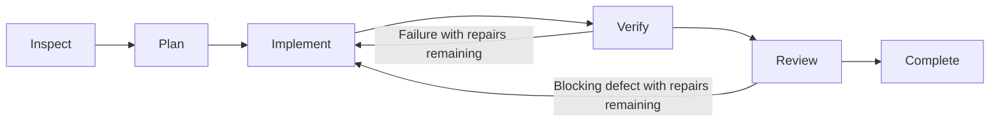

# Forge Agent

**Connect your chosen model to understand, change, and check local projects from your browser.**

[简体中文](README.md) · English

[](https://github.com/sun-sh/forge-agent/actions/workflows/ci.yml)
[](https://nodejs.org/)
[](LICENSE)

Forge Agent is an open-source coding agent for local projects, with a Web workspace as its primary interface: projects and conversations on the left, chat in the center, and Git diffs, project files, and terminal output on the right. Connect compatible third-party or local model services, manage MCP, Skills, and scoped memory, or use the optional terminal client.

Forge makes the delivery boundary around a model coding task inspectable: preserve the goal and constraints as structured state, bind verification to the current workspace, use an independent read-only review in the planned workflow, and recover or repair within explicit budgets. Pi continues to own the model and tool loop; Forge owns the engineering control plane. Whether these controls improve reliability over direct execution is measured with fixed repository tasks and published evidence.

Built on the complete [Pi Coding Agent](https://github.com/earendil-works/pi) **1.4.0** runtime, Forge focuses on **task orchestration, tool policies, verification gates, reviewable changes and memory, background execution, and recovery**. Version **0.2.0** is intended for local development and early feedback, with source installation, package checks, and a GitHub tag release workflow.

[Quick start](#quick-start) · [Design and ownership](#design-and-ownership) · [User guide](docs/usage.en.md) · [Architecture Deep Dive](docs/architecture-deep-dive.md) · [Evaluation](docs/evaluation.md)

## Quick start

Install Git and **Node.js >= 22.19.0**, and have access to a model service.

```bash
git clone https://github.com/sun-sh/forge-agent.git
cd forge-agent
npm ci
npm run build
npm start
```

`npm start` launches the local gateway and opens your default browser on port `4317`. Normal startup handles browser authorization automatically. Use `npm start -- --port 4328` for another port.

1. Open **Settings → Service → Add service** (`设置 → 服务 → 添加服务`). Enter a Base URL, protocol, and API key, or explicitly select the no-key option for a compatible local service. Discover and select models, or enter their IDs manually; test an actual invocation and save.
2. Choose the model, reasoning effort, and working mode below the composer. A first-time user does not need to choose a folder: sending the first message creates an independent project under `FORGE_AGENT_HOME/projects`. The project picker can also create one explicitly or open an existing folder elsewhere on the computer.
3. Describe the task, for example: **“Fix the failing login tests, preserve the existing API, and run project verification.”** Configure `forge-agent.json` below if you want automatic project checks. Use the paperclip next to Send to select images, UTF-8 text, and source files; drag and drop and pasted images also work.

The provider editor supports APIs compatible with **OpenAI Chat Completions, OpenAI Responses, and Anthropic Messages**. Local services such as Ollama and LM Studio need to expose a compatible endpoint. Reasoning options follow the model's capabilities; changes selected during a run apply to the next message. The Web interface is currently in Chinese.

The Web model picker offers providers with credentials or configuration saved in the Forge data directory. Credentials inherited from the launching application do not automatically add models. Explicit environment references in `models.json` remain supported.

## Workspace and capabilities

| Scenario | Current support |
| --- | --- |
| **Work by project** | Forge-managed projects and explicitly opened local folders share one project list, with removal and recovery by reopening the folder; project conversations, search, rename, pin, archive, trash, and restore; message-edit forks and Markdown / JSON export. |
| **Inspect changes** | Right-side Git diffs, files and terminal; review execution checkpoints and undo selected files while preserving earlier dirty work and refusing conflicts. |
| **Provide context** | Project text references, uploaded images and UTF-8 source/text files, user-maintained global/project/session memory, and composer-level context and Pi compaction controls. |
| **Connect models and tools** | Provider setup, model discovery and multi-select; MCP configuration, probes, browser OAuth and tool settings; Skills preview, toggles and local-directory imports. |
| **Track and recover tasks** | A right-side execution view connects phases, model responses, tool results, checks and retries; per-criterion acceptance, budgets, a durable task index, `/queue`, and detached service execution with explicit recovery after crashes. |
| **Delegate subtasks** | Exploration, review and implementation in independent worktrees; inspect and selectively apply child changes in the right panel, with conflict checks against the main project. |

File references and previews check paths, known sensitive filenames, symlinks, and size; images also have format and aggregate limits. These checks bound the Web feature's access and do not provide process isolation.

### Working modes

| Mode | Behavior |
| --- | --- |
| **Agent** | Use Pi's tools to change code and execute commands; adaptive execution is the default. |
| **Plan** | Investigate with read-only tools and propose a plan; the user switches to Agent to implement it. |
| **Ask** | Read code and answer questions. |

Plan / Ask restrictions apply to actual tool calls, including dynamic and nested calls. Built-in readers and search remain available; writes, shell, MCP/custom tools, and automatic project verification are blocked. Trusted extension code still has the launching user's permissions.

### Workflows

**Adaptive execution is the default**: Pi runs model/tool turns, the model chooses its steps, and Forge enforces verification when checks are configured.

The host controls stages only after you explicitly select **Plan and execute** (`规划并执行`) in Agent's secondary menu. Code-changing requests follow this flow:



Intent hints and the user's permission mode are recorded separately. Planned user prompts first produce schema-validated goals, constraints, acceptance, file scope and unresolved questions in a read-only inspection turn, then resolve to implementation, an answer, verification or clarification. Regex hints do not select stages. Adaptive runs keep Pi in charge of model/tool turns, and hints do not affect completion gates. The host assigns `A1…` acceptance identities; planning cannot remove preserved constraints or criteria. Implementation and review carry them forward, with evidence required for each finding. Invalid handoffs stop. Model-authored plans cannot expand authorization or replace configured verification commands.

Completion requires passing configured checks, current workspace-content and command-configuration evidence, a structured `ready` model review without unresolved issues, and exact confirmed coverage of every acceptance criterion. Verification and review repairs share a bounded allowance; every repair reruns verification and review. Missing checks, omitted acceptance findings, invalid review, or stale evidence leave the task needing attention. Questions and verification-only requests take shorter paths.

Adaptive and planned runs share host finalization. Pending child changes prevent completion; checkpoint sealing, mode restoration or task-persistence errors fail the task. The UI, queue and task index consume the same final result while historical passing checks remain available.

Continuing a stopped task, including after a service restart, preserves its original workflow: adaptive tasks continue through Pi directly, while planned tasks restart with read-only inspection. Resuming never silently adds the planned pipeline.

Select **Execution history** (`执行记录`) beside task progress to inspect phases, model usage, tool results, checks and repeated implementation attempts in the right panel. Records are projected from Pi history and host state, survive reopening, and never infer success for calls without results. This is read-only inspection rather than arbitrary side-effect replay.

Execution, automated checks and model review are shown separately; adaptive execution never implies a review that did not run. Undo, proposal application and terminal operations invalidate old evidence, and opening history rechecks external changes. Content observations have explicit scope and size limits; unconfirmed versions retain historical output and request a recheck. See the [usage guide](docs/usage.en.md).

This makes execution inspectable; the benefit of extra planning and independent review over direct execution still needs measurement. Verification repairs and per-execution time, model-turn, tool-call, token, and cost limits are bounded. An exhausted budget becomes a recoverable `budget_exceeded` task state.

A public real-repository pilot is documented in [DeepSeek pinned-repository pilot](docs/evaluations/deepseek-swe-multilingual-pilot-2026-11-09.md). The same Axios task ran once through each workflow: direct passed the oracle but was classified as a false completion after protected files changed, while planned was recorded as infrastructure failure after a long test command and Windows cleanup issue. This is evidence for delivery gates and failure classification, not a 20-task score, competitor comparison, or industry ranking.

### Subagents

The parent can use `subagent` to delegate up to three parallel tasks. A delegation may carry a structured handoff with file scope, expected deliverables, acceptance criteria, and dependencies; it focuses the child and makes the result auditable without granting extra permissions. `explorer` and `reviewer` are read-only; `worker` uses built-in readers, search, write and edit in a detached Git worktree seeded with eligible current working files. Children cannot write the main project, run shell commands, call MCP, load external extensions, or delegate further. Each child has an independent Pi context and inherits the model and reasoning effort at delegation, and its result is required to state completed work, unverified items, and what the parent must handle. Planned delivery requires a separate, fresh-context reviewer gate using the goal, preserved acceptance criteria, observed changes and verification evidence.

Async start returns handles so the parent can continue independent work. Pi's settlement boundary returns unread results for synthesis; the host refuses completion when collection is incomplete. A compact header control shows state, duration and tokens; the right panel exposes records and Stop. Review selected worker diffs and apply them, or choose **Apply and verify** to run configured main-project checks without another model call. Conflicting edits are refused, and application creates an undo checkpoint. Cleanup preserves proposals and transcripts. Read-only children support follow-ups; writers require new delegation. Parent cancellation drains active children. Separate child models and direct child-panel messages remain unsupported.

### Checkpoints and background operation

Agent executions in trusted Git repository roots capture working-file checkpoints. Open **Changes → Execution checkpoints** to select an execution, preview files, and undo selected changes. Recovery restores pre-execution content without resetting Git. HEAD/index changes, later file edits, links, or stale revisions prevent unsafe recovery. Ignored files, known sensitive paths, links and oversized files are excluded. Each snapshot is bounded to 1,500 files, 32 MB total and 2 MB per file.

To continue after closing the launching terminal, first stop the foreground gateway, then run:

```bash
node dist/pi-cli.js service start
node dist/pi-cli.js service status
node dist/pi-cli.js service stop
```

After the first conversation turn, add subsequent text tasks in the **task center** or use **`/queue task text`**. The queue runs up to three different projects concurrently and preserves order within each project and session. Busy projects do not block unrelated projects. Stop running jobs individually, cancel queued jobs, open their sessions or explicitly requeue. Model, effort and workflow are frozen at admission; trust and session state are checked again at execution. Browser closure does not stop work. Restart preserves queued jobs and marks started jobs interrupted without replaying tools. See [task scheduling](docs/task-scheduling.md) and [operations](docs/operations.md).

### Execution budgets

**Settings → About → Execution budget** controls adaptive and planned runs. New installations default to 60 minutes, 150 model turns, 300 tool calls, a 200,000 generated-token cap, a disabled cumulative request-token guard (`0`), and 25 USD; saved limits are preserved. Usage still records input, output, and cache reads, but a large cache read does not stop a default run. Missing prices are shown as unknown. Counters persist with the task and do not reset during internal continuation. Adjusting limits allows a recheck. Provider usage normally arrives at response end, so this is an execution guard rather than a billing-level isolation boundary.

Child turns, tools and usage also count toward the parent's aggregate budget. Ordinary child activations have limits of three minutes, 12 model turns, 60 tool calls, 16,000 generated tokens and 2 USD. The host's independent delivery-review gate has a fresh context and limits of five minutes, 24 model turns, 120 tool calls, 32,000 generated tokens and 4 USD. These remain capped by the parent limits. One user request can delegate at most 12 ordinary activations; the host review gate is admitted separately and always starts a new context.

## Design and ownership

Forge implements product and control behavior above Pi sessions and reuses Pi's model/tool loop instead of reimplementing a second runtime.

| Forge implementation | Problem it addresses | Code |
| --- | --- | --- |
| **Task state and recovery** | Structured goals and acceptance, shared finalization, phase/tool records, bounded repairs, stall detection and explicit re-inspection. | [Controller](src/task/controller.ts), [handoff protocol](src/task/plan.ts), [lifecycle](src/task/lifecycle.ts), [execution projection](src/task/timeline.ts), [task index](src/task/registry.ts) |
| **Execution ownership and budgets** | One Web owner per home; Agent, terminal and project-trust changes share a canonical project lock; every execution has time, turn, tool, token and cost limits. | [Home lease](src/task/registry.ts), [project execution](src/web/executions.ts), [budget](src/task/budget.ts) |
| **Child lifecycle** | Independent Pi contexts, asynchronous start and synthesis, restricted tools, aggregate budgets, cancellation and ownership checks. | [Subagent manager](src/web/subagents.ts), [design](docs/subagents.md) |
| **Verification and execution evidence** | Exact failed output, workspace/configuration binding, stale evidence invalidation, timeouts and child-process tree termination; failed verification cannot count as successful completion. | [Verification extension](src/verification/pi-extension.ts), [workspace evidence](src/verification/evidence.ts), [command executor](src/tools/command.ts) |
| **Tool policies** | Enforce read-only modes during execution rather than relying on hidden UI controls. | [Mode policy](src/web/modes.ts) |
| **Change and context adapters** | Git evidence, snapshots, conflict detection and controlled recovery; scoped memory, reviewed candidates and provenance. | [Checkpoints](src/task/checkpoints.ts), [worktrees](src/task/worktrees.ts), [memory](src/web/memory.ts) |
| **Background tasks** | A detached process, cross-project concurrency, per-project FIFO, frozen settings, independent stops and explicit crash recovery. | [Queue](src/task/queue.ts), [service](src/web/service.ts) |
| **Web product layer** | Streaming, event reconnection, history forks, model/MCP/Skills management and execution-result presentation. | [Web gateway and UI](src/web/) |

**Pi owns** the agent loop, model calls and authentication, built-in tools, session trees, compaction, project trust, MCP protocol and execution, Skills, extensions, and resource discovery. Forge's MCP management reuses Pi's protocol and authorization capabilities. Pi also supplies the terminal interface.

Memory recall is scoped to the active task. Constraints and preferences take priority; facts and decisions use inspectable English/Chinese lexical matching. Settings show selected items and budgets. Planned runs persist structured goals, complete constraints and acceptance, file scope and unresolved questions separately. Compaction checkpoints restore these before adding phase summaries; the full original request remains in the task record. Adaptive and legacy records without a structured brief use an explicitly marked head/tail excerpt, which cannot guarantee coverage of every requirement. Models can use `memory_proposal` to suggest project/session memory; candidates become active only after acceptance in **Settings → Memory**. Rejection, deduplication, provenance, explicit replacement and revision checks are supported. Forks do not inherit pending candidate ownership. Pi owns compaction; vector retrieval and measured quality gains remain future work. `archive/prototype/` is outside the supported build.

## Configure verification

Create `forge-agent.json` in the target project root; YAML is also supported. Replace these commands with your project's actual checks:

```json
{
  "verify": [
    { "name": "typecheck", "command": "npm run typecheck", "timeoutMs": 120000 },
    { "name": "test", "command": "npm test", "timeoutMs": 300000 }
  ],
  "verifyRetries": 2,
  "protect": ["tests", "package-lock.json"]
}
```

Only `verify`, `verifyRetries` and `protect` are accepted; unknown fields are errors. Checks require Pi project trust. Exact failed output is returned to the model, and internal continuations do not reset the repair count. Persistent failures produce a nonzero CLI exit status. Outcomes are recorded in the Pi session branch; raw output and reports live under `FORGE_AGENT_HOME/verification`.

See the [JSON Schema](forge-agent.schema.json). For terminal entry points, run `npm link`, then use `forge-agent`, `forge-agent check`, or `forge-agent -p "task"`.

## Development and evaluation

| Command | Purpose |
| --- | --- |
| `npm run check` | Types, active regression tests, build and CLI/bin checks. |
| `npm run test:web` | Web interaction acceptance in real Edge / Chrome / Chromium, using a local fixture model. |
| `npm run eval:smoke` | Scripted solutions exercise tools, workflows and evaluation plumbing. |
| `npm run eval:agent -- --model provider/model --workflow direct` | Run the fixed task suite against a real model; startup checks availability and copies the model catalog and credentials into an isolated evaluation home. |
| `npm run eval:agent -- --model provider/model --workflow planned` | Run the same suite through planned execution for comparison. |
| `npm run eval:agent -- --model provider/model --workflow both --repeat 3` | Repeat both workflows with fixed model settings and compare pass rate, latency, repairs, tokens, and cost. |
| `npm run eval:repo -- --suite path/to/suite.json --prepare` | Inspect pinned repository commits, commands and an independent oracle fingerprint without calling a model or running repository code. |
| `npm run eval:repo -- --suite path/to/suite.json --model provider/model --workflow both --repeat 3 --trust-suite` | Clone pinned repositories into isolated workspaces, enforce protected files and verification, and record independent results and false completions. Review and trust the suite before execution. |
| `npm run eval:repo -- --suite path/to/suite.json --model provider/model --workflow both --trust-suite --validation path/to/cohort-validation.json` | Reuse baseline/reference validation for the matching suite fingerprint; invalid tasks are explicitly skipped without sending a model request. |
| `npm run pack:check` | Check tarball assets, excluded private files and the packaged CLI. Release CI adds `--install` for a clean dependency installation. |

Evaluations use an isolated temporary Forge home and workspace, copying only the selected source's model and authentication configuration. The small public suite provides quick regressions. Repository evaluations require a pinned commit and a standalone Node oracle outside the workspace, and check protected files, verification gates and completion state. Reports record suite and oracle fingerprints, model, workflow, false completions, latency, budgets, tokens and cost. `--trust-suite` confirms that you have reviewed and authorized the repository resources, setup commands and oracle code. For a fixed cohort, validate the baseline and a known-correct reference patch first, then pass `--validation` to bind execution to that suite fingerprint; invalid or infrastructurally broken tasks are recorded as `validationSkipped` / `infrastructureFailure` and do not send model requests. On Windows, the evaluator waits for Pi's child process tree to terminate before removing a worktree; a cleanup failure still produces a report and is counted as infrastructure. Passing regressions, scripted models or evaluation infrastructure does not establish real coding performance; complex-repository results are reported in [evaluation methods](docs/evaluation.md).

## Current scope

- **Runtime and delivery:** local Web and optional terminal clients; the Web UI is Chinese. A detached service, package checks and tag release workflow are implemented; npm publication and desktop installers are not claimed.
- **Concurrency and recovery:** one Web owner per `FORGE_AGENT_HOME`. Agent, terminal, trust changes, checkpoint recovery and proposal application share project ownership. The queue runs up to three different projects concurrently, serializes each real project and never automatically retries an interrupted execution.
- **Compatibility:** providers offer an optional three-request check for streaming text, tool-call arguments and tool-result continuation. This checks the selected endpoint/model; real OAuth, enterprise proxy, rate-limit and vendor-specific compatibility still require service acceptance.
- **Evidence still needed:** larger real-model repository comparisons and measured memory/planning gains. The pinned-repository evaluator provides the infrastructure; fixture tests do not establish coding quality or frontier performance.

Reproduced issues, impact, and acceptance criteria are recorded in the [product review](docs/product-audit.md) (Chinese).

## Data and security

Local data defaults to `~/.forge-agent`, overridden by `FORGE_AGENT_HOME`. Legacy `PFORGE_HOME`, `~/.pforge`, and `pforge.json/yaml/yml` remain compatible. The gateway does not automatically treat its launch directory as the first project.

Forge-managed projects live under `FORGE_AGENT_HOME/projects`, with the project index at `FORGE_AGENT_HOME/web/projects.json`. When you open an external folder, Forge stores its canonical path and works in place; it does not move or copy that project. A project directory is created lazily when the first message is sent without a selected project. Pi sessions remain centralized under `FORGE_AGENT_HOME/sessions`, so projects, conversations, and forks can be managed together on the local machine.

The gateway binds to `127.0.0.1` by default and uses a local credential, an HttpOnly / SameSite cookie, and Host / Origin checks. Model keys are saved through Pi's authentication API, never returned to the editor or stored in browser storage.

Local operation describes the client and execution process. A remote model still receives relevant content. Agent tools, MCP, trusted extensions, and verification commands have the launching user's OS permissions; project trust is not an OS sandbox. Review sessions and logs for sensitive content before sharing. See [security notes](SECURITY.md).

## Documentation and contributions

- [User guide](docs/usage.en.md): modes, commands, context, memory, Skills, MCP, sessions, and local data.
- [Architecture and ownership](docs/architecture.md): responsibilities of Pi and Forge.
- [Architecture Deep Dive](docs/architecture-deep-dive.md): execution, evidence, scheduling, context and recovery tradeoffs, with an English overview.
- [Execution records and acceptance handoffs](docs/execution-records.md): the right-side execution view, phase/tool provenance, acceptance identities and record limits.
- [MCP management](docs/mcp-management.md) · [Evaluation](docs/evaluation.md) · [Product review](docs/product-audit.md).
- [Contribution workflow](CONTRIBUTING.md) and [contributor rules](AGENTS.md): code and related documentation change together; completion, retries, trust, persistence, and security changes require regression tests.

Report issues with sanitized reproduction steps through [Issues](https://github.com/sun-sh/forge-agent/issues), or contribute within these boundaries.

## License and acknowledgments

[MIT License](LICENSE). Thanks to [Pi](https://github.com/earendil-works/pi) and the project's open-source dependencies.

`protect` fingerprints literal project-relative files and directories before model execution. It preserves pre-existing dirty content; changes or incomplete observations block delivery even when commands pass. This is a delivery check, not an OS sandbox.
