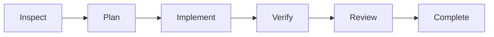

# Forge Agent

**Read, plan, and change code in a local browser, with verification and review evidence behind task completion.**

[简体中文](README.md) · English

[](https://github.com/sun-sh/forge-agent/actions/workflows/ci.yml)
[](https://nodejs.org/)
[](LICENSE)

Forge Agent is a local coding agent with a Web client as its primary interface. Projects, conversations, model selection, task progress, and Git diffs share one workspace. An optional command-line interface is also available.

It builds on the complete [Pi Coding Agent](https://github.com/earendil-works/pi) **1.4.0** runtime. Forge Agent adds task orchestration, working-mode policies, verification gates, Git change review, and Web interactions above Pi sessions. The current version is **0.1.0, in early development**.

## What you can do

- **Work by project:** expand, search, and reopen project history; retain drafts; inspect changed files and diffs. Session menus support rename, pin, archive, trash, and restore.
- **Export reusable records:** export the current or historical conversation as Markdown or structured JSON without changing the source session or branch.
- **Branch a turn:** message actions can edit a user message into a new branch or continue from a complete answer. The original session remains intact, and the branch uses Pi's native session file and context.
- **Choose how to work:** Agent uses **Adaptive execution** by default. Expand the small arrow beside Agent to opt into **Plan and execute**; Plan investigates and proposes a plan, while Ask reads code to answer questions. Select the project, mode, model, and reasoning effort below the composer.
- **Connect your models:** add a compatible provider in settings, discover models with a searchable multi-select, or enter model IDs manually. Test an actual model invocation before using it.
- **Manage skills:** search global and project skills, preview instructions, enable or disable them, and import local skill directories. Saved changes update idle sessions and their command menus.
- **Use scoped memory and compaction:** manage global, project, and session memory from Settings. Project memory stays with its folder, session memory follows the Pi session tree and forks, and the composer exposes Pi's context usage and automatic compaction state.
- **Connect external tools:** add local or HTTP services in MCP settings, import configuration, complete browser OAuth, configure individual tools, and inspect each session's connection state.
- **Inspect completion evidence:** use the planned workflow for complex tasks, with visible investigation, planning, implementation, verification, and review stages.

## Quick start

Install Git and **Node.js >= 22.19.0**, and have access to a model service. Remote services usually need an API key; compatible local services can use the explicit no-key option.

```bash
git clone https://github.com/sun-sh/forge-agent.git
cd forge-agent
npm ci
npm run build
npm start
```

`npm start` launches the local gateway and opens your default browser on port `4317`. Normal startup handles browser authorization automatically. To use another port, run `npm start -- --port 4328`. Installation is currently from source; an npm package and desktop installer have not been published.

For your first task:

1. Open **Settings → Service → Add service** (`设置 → 服务 → 添加服务`). Enter a name, Base URL, API protocol, and API key, or explicitly select the no-key option for a local service.
2. Fetch the model list and select models in the searchable checkbox dropdown. Enter IDs manually if the provider has no listing endpoint. Run an actual invocation test, then save the service.
3. Select a project, model, and supported reasoning effort below the composer. Saving a service and switching the active conversation's model are separate actions.
4. Inspect the project and its verification commands, then confirm project trust in settings. Configure `forge-agent.json` as described below to use the verification gate.
5. If you need external tools, add a service under **Settings → MCP** and test the connection. HTTP services requiring OAuth have a **Sign In** (`登录授权`) action.
6. Describe the task and send it. Agent defaults to **Adaptive execution**, letting the model choose the steps it needs. The host's staged workflow runs only when you manually select **Plan and execute** (`规划并执行`).

The provider editor supports APIs compatible with **OpenAI Chat Completions, OpenAI Responses, and Anthropic Messages**. Services such as Ollama and LM Studio need to expose a compatible endpoint. Capabilities come from the catalog or explicit configuration; reasoning levels are not inferred from model names. The Web interface is currently in Chinese.

## Working modes and workflows

The working mode controls which tools may run:

| Mode | Purpose | Available tools |
| --- | --- | --- |
| **Agent** | Implement changes, run commands, and verify the project | Tools enabled by Pi configuration and project trust |
| **Plan** | Read the project and propose an implementation plan | Built-in read/search tools only |
| **Ask** | Understand code, explain behavior, and answer questions | Built-in read/search tools only |

Plan and Ask enforce restrictions on actual tool calls, blocking shell, writes, MCP/custom tools, extension/skill/template command dispatch, and automatic verification. Local interface commands for viewing context, choosing models, and opening settings remain available. Modes persist with the session and cannot change during a run. These policies restrict model-driven operations; trusted extension code still has the launching user's permissions.

Agent mode offers two workflows:

- **Adaptive execution (default)** (`自适应`): use Pi's interaction loop for everyday questions and changes, letting the model choose its steps, with configured verification.
- **Plan and execute (opt-in)** (`规划并执行`): a Forge Agent controller advances through the stages below, while Pi executes every model and tool turn.

The toolbar normally shows just **Agent**. Its workflow options sit behind a small arrow that stays collapsed until opened; a small planning badge appears only after opting in. The selection persists within the current session, including history recovery, while every new conversation starts adaptive. Web prompts explicitly include the selected workflow; API prompts that omit `workflow` default to adaptive. Planned execution also routes by request intent: capability questions and read-only analysis use one restricted read turn, explicit verification requests go straight to the verification gate, and only code-changing requests enter the full staged pipeline.



The planned workflow's completion gate requires passing configured verification, a structured `ready` review with no unresolved issues, and no detected changes during review within the available Git evidence. Verification failures receive at most `verifyRetries` automatic repairs. Review findings, missing checks, invalid review output, or stale evidence leave the task needing attention.

Stopping a task prevents later stages. After a service restart, unfinished work is marked interrupted. **Re-inspect and continue** (`重新检查并继续`) explicitly starts a fresh inspection of the current workspace. The model review is a second pass and can still miss defects.

Model and reasoning changes remain available while a run is active. They are staged locally and applied immediately before the next message, so the current turn keeps its configuration. Project, working mode, workflow, settings, and new-chat actions are locked during execution. Thinking, tool calls, and phase output are grouped under a collapsed **Execution process** section while the final answer remains prominent. Press `Enter` to send and `Shift+Enter` for a newline.

## Composer commands and context

Type `/` in the composer or select **Commands** (`命令`) below it to search for an action. Use `↑` / `↓` to select, `Enter` to execute, `Tab` to complete, and `Esc` to close.

| Command | Purpose |
| --- | --- |
| `/new`, `/rename` | Start a conversation or rename the current one |
| `/model`, `/mode` | Open model/reasoning selection or working-mode selection |
| `/context` | Inspect the current context estimate, capacity, cumulative usage, and automatic compaction status |
| `/compact [instructions]` | Compact earlier content, optionally specifying what the summary should retain |
| `/changes` | Open the Git changes panel on the right |
| `/mcp`, `/settings`, `/help` | Open MCP settings, general settings, or command and keyboard help |

The menu separates actions, skills, and templates; extensions appear when loaded. Chinese titles distinguish model selection (`/model`) from working modes (`/mode`), and a fully typed command shows only its exact match. Select the **Skills** (`技能`) category to load the current project's skill list. Choosing a skill fills `/skill:name` into the composer so you can add the task before sending. Browsing and selecting skills do not request a model; Pi handles execution. The model can also read suitable skills on demand. Unavailable actions explain why, and unknown commands stay in the composer for editing. Model and reasoning changes selected during a run still apply to the next message.

Context usage and **Compact** (`压缩`) stay below the composer. Open the context details for cumulative input/output, cache usage, catalog-estimated cost, and compaction count; cumulative usage is shown separately from current window usage. Manual compaction calls the current model, requires an idle session, and can be cancelled. Conversation history is retained. After compaction, the old usage estimate is hidden until the next model response updates it.

Open **Settings → Memory** (`设置 → 记忆`) to maintain three layers of reference material: global memory is reused across projects, project memory is injected only for the current folder, and session memory is stored in the Pi session tree and retained by forks. Each item can be marked as a fact, preference, decision, or constraint and can be disabled independently. Memory is injected as user reference material and never grants tool permissions. The page also shows Pi's automatic compaction switch, `reserveTokens`, `keepRecentTokens`, and the number of compactions in the current session.

## Manage skills

Open **Settings → Skills** (`设置 → 技能`), or select **Manage skills** from the command menu's Skills category. Search by name, description, or source; filter by global/project scope; inspect instructions and diagnostics. Automatic invocation, manual-only skills, disabled skills, and name collisions have distinct statuses.

Expand **Add local skills** to reference a directory containing `SKILL.md` or an existing Markdown skill file. Choose global or project scope. Removing an imported reference preserves local files; switches disable resources in automatically discovered directories. Project resources still require project trust. Saving or refreshing reloads idle sessions and updates their `/` menus without restarting the service.

Discovery, name precedence, filtering, and persistence use Pi's native mechanisms. Browsing and previewing do not call a model, load project extensions, or install missing packages for the management view.

## Agent design and ownership

Forge Agent places product behavior above Pi sessions, with explicit responsibilities:

| Layer | Responsibility and implementation |
| --- | --- |
| **Task controller** | [src/task/controller.ts](src/task/controller.ts): phase transitions, bounded repair, stop/resume, branch-persisted task state, and completion gates. |
| **Verification and evidence** | [src/verification/](src/verification/) and the [command executor](src/tools/command.ts): exact output, timeouts, child-process tree termination, and per-run reports. |
| **Working-mode policy** | [src/web/modes.ts](src/web/modes.ts): a Pi extension constrains actual tool calls, including nested and dynamically activated tools. |
| **Git review** | [src/task/git.ts](src/task/git.ts): staged, unstaged, and untracked changes; bounded diff previews; pre-existing change labels and status fingerprints. |
| **MCP management** | [Configuration and authorization](src/web/mcp.ts), the [runtime adapter](src/web/mcp-runtime.ts), and [settings UI](src/web/ui/mcp.js): global/project configuration, connection tests, browser authorization, tool rules, and session status. Pi owns protocol and execution. |
| **Web product layer** | [src/web/](src/web/): provider settings, project sessions, streaming, reconnect recovery, drafts, task progress, and change panels. |
| **Underlying runtime** | Pi: agent loop, model calls and authentication, tools, sessions and compaction, project trust, MCP, skills, extensions, and resource discovery. |

The implementation keeps one agent loop. The CLI delegates to Pi's entry point; the Web gateway creates sessions through Pi's SDK. The task controller owns stages and decisions, and Pi executes each model/tool turn. Earlier custom prototypes remain in `archive/prototype/`, outside the active build, tests, and supported feature set.

See [architecture and capability boundaries](docs/architecture.md) and the [UI design notes](docs/ui-design-notes.md) (Chinese).

## Connect MCP services

Open **Settings → MCP → Add** (`设置 → MCP → 添加`). Choose local STDIO or Streamable HTTP, then enter a command and arguments, or a URL and headers. You can also expand **Import from JSON** (`从 JSON 导入配置`), paste another client's `mcpServers` configuration, and choose one service to fill the form. Enter one command argument per line; keep a path containing spaces on the same line.

Choose **Test current configuration** (`测试当前配置`), inspect the connection result and available tool catalog, then save. If an HTTP service reports that OAuth is required, choose **Sign In** (`登录授权`) after saving and approve access in the browser. The callback completes automatically. If popups are blocked, use the authorization link. Pasted redirects, cancellation, and removing local authorization are also supported. MCP authorization and model-provider sign-in are managed separately.

- **Global and project scope:** global configuration lives at `FORGE_AGENT_HOME/mcp.json`; project configuration lives at `<project>/.pi/mcp.json` and loads only after project trust. A same-name project entry can replace a global service, or override only its enabled state and tool exposure. A partial override does not copy global credentials into the project.
- **Connection tests:** a temporary Pi session opens a real connection and reports the latest result and discovered tools. It does not request a model or call tools. Testing starts the service process and closes the connection afterward. Results do not describe every chat session's live connection state.
- **Applying changes:** saving, toggling, or deleting reloads affected idle sessions through Pi. Stop active tasks before changing configuration. Existing working-mode restrictions remain in force.
- **Tool Settings:** configure individual tools, add wildcard rules, or restore inheritance. Existing `toolExposure` rules are preserved. Exact names take precedence over wildcard rules; the first matching wildcard rule wins. Plan and Ask continue to block MCP tool execution.
- **Session connections:** inspect the services actually loaded in each conversation in the current project. Status and tool counts refresh every three seconds; idle sessions can reconnect.
- **Credentials and editing:** saved environment values, header values, and OAuth client secrets are not returned to the editor. Leave them blank to retain existing values; remove a row or select secret removal to clear them. Concurrent edits are checked for conflicts. Authorization completion and status refresh preserve open editor drafts.

Open **Tool Settings** (`工具设置`) on a service card to choose how its tools are made available:

| Mode | Behavior and use case |
| --- | --- |
| **Codemode** (default) | The agent discovers and combines tools in scripts, useful when calls or results need composition and filtering. |
| **Deferred** | Tools are loaded through search when needed, useful for services with many tools. |
| **Direct** | Tools are declared directly to the model and remain callable from scripts, useful for a small set of frequently used tools. |
| **Hidden** | Tools are hidden and cannot be called. |

Pi owns MCP protocol, transports, tool discovery, execution, and OAuth. Browser authorization refreshes idle sessions; running sessions refresh after their current task ends. Put credentials in environment, header, or OAuth secret fields rather than command arguments or URLs. Changing a connection target requires re-entering credentials you want to retain. External vendors' OAuth metadata, registration policies, and proxy environments still need compatibility checks with those services. See the [MCP management design](docs/mcp-management.md) for implementation details.

## Configure project verification

Create `forge-agent.json` in the target project root. `forge-agent.yaml` and `forge-agent.yml` are also supported. Replace these commands with the checks your project actually uses:

```json
{
  "verify": [
    { "name": "typecheck", "command": "npm run typecheck", "timeoutMs": 120000 },
    { "name": "test", "command": "npm test", "timeoutMs": 300000 }
  ],
  "verifyRetries": 2
}
```

- Only `verify` and `verifyRetries` are accepted. Unknown fields are errors. The [JSON Schema](forge-agent.schema.json) defines the full constraints.
- Verification commands run only after Pi trusts the project.
- Exact failed command output is returned to the model, with at most `verifyRetries` repair attempts. Internal continuations do not reset the budget. Persistent check failure produces a nonzero CLI exit status.
- Timeouts and command-start failures also produce failed reports. Cancellation retains partial output and stops further checks and automatic repairs. Starting a new verification invalidates an older passing result.
- Per-workspace and per-run reports live under `FORGE_AGENT_HOME/verification`, with outcomes also recorded in the Pi session branch. The Web client displays associated verification and review evidence.

## Optional command-line entry points

Run `npm link` once from the source directory if you want the command on your PATH:

```bash
forge-agent web                            # Start the Web client
forge-agent                                # Pi's interactive terminal interface
forge-agent doctor                         # Inspect local setup without printing credentials
forge-agent check                          # Run the current project's configured checks
forge-agent -C path/to/project -p "Fix the failing tests"
```

The Web API-key editor covers common compatible services, and MCP has a dedicated settings entry. Provider OAuth still uses `/login` in the terminal interface. Pi manages advanced skill and extension configuration; the Web client uses the same local configuration.

Sessions are stored under `FORGE_AGENT_HOME/sessions`. The sidebar groups them by project, and menu actions persist through Pi session metadata. Archive and trash change the Web presentation state while retaining the original session file for recovery. A fork creates a new Pi session file and records its origin; it does not send a model request automatically. Editing a user-message fork places the text back in the composer.

## Validation and development

| Command | What it checks |
| --- | --- |
| `npm run check` | Type checking, active regression tests, build, and CLI/bin integration. |
| `npm run test:web` | A real Chromium browser against local fixture services: model setup, scoped memory and Pi compaction controls, MCP authorization and tool settings, history menus, archive/restore, message forks, session connections and recovery, task progress, Git diffs, and narrow layouts. |
| `npm run eval:smoke` | Fixed coding tasks with scripted solutions, executed through actual Pi tools and workflows, then checked with held-out assertions, workspace integrity, verification gates, and completion gates. |
| `npm run eval:agent -- --model provider/model --workflow planned` | The same task set with a configured real model. Sends task content to the provider and incurs its usage charges. |

Browser acceptance needs Edge, Chrome, or Chromium; set `FORGE_AGENT_TEST_BROWSER` to another executable if necessary. It uses a temporary project, isolated data directory, and browser profile. See [evaluation](docs/evaluation.md) for methods, output paths, and limits. Changes to completion, retry state, trust, persistence, or security require regression tests; follow [AGENTS.md](AGENTS.md).

## Local data and security

| Data | Default location |
| --- | --- |
| Configuration, models, and authentication | `~/.forge-agent`, overridden by `FORGE_AGENT_HOME` |
| Global MCP configuration and OAuth credentials | `FORGE_AGENT_HOME/mcp.json` and `FORGE_AGENT_HOME/mcp-auth.json` |
| Project MCP configuration | `<project>/.pi/mcp.json`, loaded only after project trust |
| Sessions | `FORGE_AGENT_HOME/sessions` |
| Global and project memory | `FORGE_AGENT_HOME/memory`; session memory is stored in the Pi session tree |
| Verification evidence and raw output | `FORGE_AGENT_HOME/verification` |
| Local gateway access credential | `FORGE_AGENT_HOME/web/access-token` |

Legacy `PFORGE_HOME`, `~/.pforge`, and `pforge.json/yaml/yml` remain compatible. New `forge-agent.*` configuration takes precedence in the same directory. Existing sessions retain compatible storage identifiers.

The Web gateway binds to `127.0.0.1` by default, uses a local access credential and an HttpOnly, SameSite=Strict cookie, and checks Host and Origin. Model API keys are stored through Pi's authentication API; the editor does not return them or store them in browser storage.

Local operation describes where the client, process, and data live. With a remote model, relevant content is still sent to your configured provider. Agent tools, trusted extensions, and verification commands have the launching user's OS permissions. Project trust is not an OS sandbox; use a container, VM, or restricted account for untrusted projects. Sessions and raw logs can contain sensitive data, so inspect them before sharing. See [security notes](SECURITY.md).

## Current scope and next priorities

The current release is intended for local use, development, and early feedback. The Web interface is in Chinese, and further work includes:

- Advanced provider settings and resource management; some provider sign-in, skill, and extension configuration currently uses Pi's TUI/configuration.
- An independent background-task queue, plus file references and attachment input; archive, trash, rename, pin, restore, message forks, and session export are already persisted through Pi sessions.
- Real-model evaluation on larger repositories, comparing direct and staged workflows for quality gates, success rate, latency, and cost.
- Keyboard accessibility, installation, upgrades, and desktop distribution. No npm package, GitHub Release, or desktop installer has been published.

See the [product audit](docs/product-audit.md) (Chinese) for the full status and priorities. Report issues with sanitized reproductions through [Issues](https://github.com/sun-sh/forge-agent/issues), or contribute within the boundaries above.

## License and acknowledgments

[MIT License](LICENSE). Thanks to [Pi](https://github.com/earendil-works/pi) for the coding-agent runtime and to the project's open-source dependencies.
