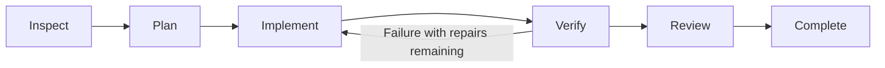

# Forge Agent

**Connect your chosen model to understand, change, and check local projects from your browser.**

[简体中文](README.md) · English

[](https://github.com/sun-sh/forge-agent/actions/workflows/ci.yml)
[](https://nodejs.org/)
[](LICENSE)

Forge Agent is an open-source coding agent for local projects, with a Web workspace as its primary interface: projects and conversations on the left, chat in the center, and Git diffs, project files, and terminal output on the right. Connect compatible third-party or local model services, manage MCP, Skills, and scoped memory, or use the optional terminal client.

Built on the complete [Pi Coding Agent](https://github.com/earendil-works/pi) **1.4.0** runtime, Forge focuses on **task orchestration, tool policies, verification gates, execution evidence, and recoverable Web interactions**. Version **0.1.0** installs from source and is intended for local development and early feedback.

[Quick start](#quick-start) · [Design and ownership](#design-and-ownership) · [User guide](docs/usage.en.md) · [Architecture](docs/architecture.md) · [Evaluation](docs/evaluation.md)

## Quick start

Install Git and **Node.js >= 22.19.0**, and have access to a model service.

```bash
git clone https://github.com/sun-sh/forge-agent.git
cd forge-agent
npm ci
npm run build
npm start
```

`npm start` launches the local gateway and opens your default browser on port `4317`. Normal startup handles browser authorization automatically. Use `npm start -- --port 4328` for another port.

1. Open **Settings → Service → Add service** (`设置 → 服务 → 添加服务`). Enter a Base URL, protocol, and API key, or explicitly select the no-key option for a compatible local service. Discover and select models, or enter their IDs manually; test an actual invocation and save.
2. Choose the model, reasoning effort, and working mode below the composer. A first-time user does not need to choose a folder: sending the first message creates an independent project under `FORGE_AGENT_HOME/projects`. The project picker can also create one explicitly or open an existing folder elsewhere on the computer.
3. Describe the task, for example: **“Fix the failing login tests, preserve the existing API, and run project verification.”** Configure `forge-agent.json` below if you want automatic project checks. Use the paperclip next to Send to select images, UTF-8 text, and source files; drag and drop and pasted images also work.

The provider editor supports APIs compatible with **OpenAI Chat Completions, OpenAI Responses, and Anthropic Messages**. Local services such as Ollama and LM Studio need to expose a compatible endpoint. Reasoning options follow the model's capabilities; changes selected during a run apply to the next message. The Web interface is currently in Chinese.

The Web model picker offers providers with credentials or configuration saved in the Forge data directory. Credentials inherited from the launching application do not automatically add models. Explicit environment references in `models.json` remain supported.

## Workspace and capabilities

| Scenario | Current support |
| --- | --- |
| **Work by project** | Forge-managed projects and explicitly opened local folders share one project list, with removal and recovery by reopening the folder; project conversations, search, rename, pin, archive, trash, and restore; message-edit forks and Markdown / JSON export. |
| **Inspect changes** | A right-side Git list and diff, project text search/preview, and user-entered terminal commands; labels for changes present before a task. |
| **Provide context** | Project text references, uploaded images and UTF-8 source/text files, user-maintained global/project/session memory, and composer-level context and Pi compaction controls. |
| **Connect models and tools** | Provider setup, model discovery and multi-select; MCP configuration, probes, browser OAuth and tool settings; Skills preview, toggles and local-directory imports. |
| **Track and recover tasks** | Planned-task phases, verification output, review records and a durable task index; interrupted work is re-inspected only after an explicit user continuation. |
| **Delegate subtasks** | Parallel exploration and review in independent Pi sessions; a compact header catalog shows state and usage, a right-side panel exposes records and Stop, and the parent collects conclusions. |

File references and previews check paths, known sensitive filenames, symlinks, and size; images also have format and aggregate limits. These checks bound the Web feature's access and do not provide process isolation.

### Working modes

| Mode | Behavior |
| --- | --- |
| **Agent** | Use Pi's tools to change code and execute commands; adaptive execution is the default. |
| **Plan** | Investigate with read-only tools and propose a plan; the user switches to Agent to implement it. |
| **Ask** | Read code and answer questions. |

Plan / Ask restrictions apply to actual tool calls, including dynamic and nested calls. Built-in readers and search remain available; writes, shell, MCP/custom tools, and automatic project verification are blocked. Trusted extension code still has the launching user's permissions.

### Workflows

**Adaptive execution is the default**: Pi runs model/tool turns, the model chooses its steps, and Forge enforces verification when checks are configured.

The host controls stages only after you explicitly select **Plan and execute** (`规划并执行`) in Agent's secondary menu. Code-changing requests follow this flow:



Completion requires passing configured checks, a structured `ready` model review with no unresolved issues, and no detected changes during review within the available Git evidence. Missing checks, invalid review, or stale evidence leave the task needing attention. Questions and verification-only requests take shorter paths.

This makes execution inspectable; the benefit of extra planning and model self-review still needs measurement. Verification repairs and per-execution time, model-turn, tool-call, token, and cost limits are bounded. An exhausted budget becomes a recoverable `budget_exceeded` task state.

### Subagents

For complex requests, the parent can use `subagent` to delegate a batch of up to three parallel read-only exploration or review tasks. Simple questions still get direct answers. Each child has an independent Pi context, inherits the model and reasoning effort at delegation, and can only use built-in file readers and search. Children cannot write, run commands, call MCP or delegate further. The parent waits for the batch, synthesizes its results, and can ask follow-up questions using a child ID. The existing planned-workflow self-review gate does not automatically become an independent multi-agent review.

A compact header control appears only when children exist. Its catalog shows state, duration and tokens; opening a row shows the child's record and Stop action on the right. Child sessions stay out of ordinary history. Stopping the parent drains its children; unfinished children become interrupted after restart without replay. Parallel writers, Git worktree isolation, separate child model settings, and direct messages from the child panel are not supported yet.

### Execution budgets

**Settings → About → Execution budget** controls each Agent execution, including adaptive and planned workflows. The defaults are 15 minutes, 50 model turns, 300 tool calls, 750,000 tokens, and 25 USD. Budget snapshots are stored with the session and task record; after changing the limits, an interrupted or budget-exhausted task can be rechecked. Provider usage is usually observable at the end of a response, so one response may slightly cross a threshold; this is an execution guard, not a billing-level isolation boundary.

Child turns, tools and usage also count toward the parent's aggregate budget. Each child activation additionally has limits of three minutes, 12 model turns, 60 tool calls, 120,000 tokens and 2 USD, capped by the corresponding parent limits. One user request can delegate at most 12 activations, including follow-ups.

## Design and ownership

Forge implements product and control behavior above Pi sessions and reuses Pi's model/tool loop instead of reimplementing a second runtime.

| Forge implementation | Problem it addresses | Code |
| --- | --- | --- |
| **Task state and recovery** | Phase transitions, stopping, bounded repairs, task discovery and explicit re-inspection; Pi sessions retain the conversation and task records. | [Controller](src/task/controller.ts), [task index](src/task/registry.ts) |
| **Execution ownership and budgets** | One Web owner per home; Agent, terminal and project-trust changes share a canonical project lock; every execution has time, turn, tool, token and cost limits. | [Home lease](src/task/registry.ts), [project execution](src/web/executions.ts), [budget](src/task/budget.ts) |
| **Child lifecycle** | Independent Pi contexts, restricted tools, reserved capacity, aggregate budgets, result collection, cancellation and ownership checks. | [Subagent manager](src/web/subagents.ts), [design](docs/subagents.md) |
| **Verification and execution evidence** | Exact failed output, bounded repairs, timeouts and child-process tree termination; failed verification cannot count as successful completion. | [Verification extension](src/verification/pi-extension.ts), [command executor](src/tools/command.ts) |
| **Tool policies** | Enforce read-only modes during execution rather than relying on hidden UI controls. | [Mode policy](src/web/modes.ts) |
| **Change and context adapters** | Git baselines, fingerprints and bounded diffs; user-maintained scoped memory and safe file references. | [Git evidence](src/task/git.ts), [memory](src/web/memory.ts), [file references](src/web/files.ts) |
| **Web product layer** | Streaming, event reconnection, history forks, model/MCP/Skills management and execution-result presentation. | [Web gateway and UI](src/web/) |

**Pi owns** the agent loop, model calls and authentication, built-in tools, session trees, compaction, project trust, MCP protocol and execution, Skills, extensions, and resource discovery. Forge's MCP management reuses Pi's protocol and authorization capabilities. Pi also supplies the terminal interface.

Scoped memory is currently user-maintained reference material injected by scope. Project memory is keyed by the canonical real directory and legacy files are validated before migration; Pi owns automatic compaction. Automatic experience extraction, retrieval ranking, and memory-quality evaluation remain future work. Earlier code under `archive/prototype/` is outside the active build and supported feature set.

## Configure verification

Create `forge-agent.json` in the target project root; YAML is also supported. Replace these commands with your project's actual checks:

```json
{
  "verify": [
    { "name": "typecheck", "command": "npm run typecheck", "timeoutMs": 120000 },
    { "name": "test", "command": "npm test", "timeoutMs": 300000 }
  ],
  "verifyRetries": 2
}
```

Only `verify` and `verifyRetries` are accepted; unknown fields are errors. Checks require Pi project trust. Exact failed output is returned to the model, and internal continuations do not reset the repair count. Persistent failures produce a nonzero CLI exit status. Outcomes are recorded in the Pi session branch; raw output and reports live under `FORGE_AGENT_HOME/verification`.

See the [JSON Schema](forge-agent.schema.json). For terminal entry points, run `npm link`, then use `forge-agent`, `forge-agent check`, or `forge-agent -p "task"`.

## Development and evaluation

| Command | Purpose |
| --- | --- |
| `npm run check` | Types, active regression tests, build and CLI/bin checks. |
| `npm run test:web` | Web interaction acceptance in real Edge / Chrome / Chromium, using a local fixture model. |
| `npm run eval:smoke` | Scripted solutions exercise tools, workflows and evaluation plumbing. |
| `npm run eval:agent -- --model provider/model --workflow direct` | Run the fixed task suite against a real model; startup checks availability and copies the model catalog and credentials into an isolated evaluation home. |
| `npm run eval:agent -- --model provider/model --workflow planned` | Run the same suite through planned execution for comparison. |
| `npm run eval:agent -- --model provider/model --workflow both --repeat 3` | Repeat both workflows with fixed model settings and compare pass rate, latency, repairs, tokens, and cost. |

Evaluation runs in an isolated temporary Forge home and workspace by default; use `--home` when you need a retained location for inspection. Real runs read the current Forge home by default, or a source selected with `--config-home <path>`. Only `models.json` and `auth.json` are copied; source sessions, tasks, and MCP state are never reused. A preflight fails before the first task when the requested model is unavailable. Reports include independent assertions, protected files, verification results, completion state, Git revision, suite fingerprint, latency percentiles, repairs, tool calls, tokens, cost, and Pi statistics. Execution budget totals also include usage charged by managed child agents. The public suite contains five small function-repair tasks, including two cross-file tasks; no real-model comparison on complex repositories has been published. Regression tests, browser acceptance, and scripted solutions do not establish model coding performance. See [evaluation methods](docs/evaluation.md).

## Current scope

- **Runtime and delivery:** local Web and optional terminal clients; the Web UI is Chinese. No npm package, desktop installer, or independent background queue has been published.
- **Concurrency and recovery:** one Web owner is allowed for each `FORGE_AGENT_HOME`. Agent, terminal, and project-trust changes share a canonical project lock, and task-index write failures surface through the task API. There is no independent background queue yet; a running task remains owned by the local gateway.
- **Compatibility:** provider OAuth uses terminal `/login`; external MCP / OAuth services, enterprise proxies, and provider-specific parameters require service-by-service acceptance.
- **Engineering priorities:** real-repository direct/planned comparisons, provider/MCP compatibility, memory-retrieval quality, controlled undo, diagnostics, and distribution still need validation. This release does not claim frontier status or proven real-repository coding quality.

Reproduced issues, impact, and acceptance criteria are recorded in the [product review](docs/product-audit.md) (Chinese).

## Data and security

Local data defaults to `~/.forge-agent`, overridden by `FORGE_AGENT_HOME`. Legacy `PFORGE_HOME`, `~/.pforge`, and `pforge.json/yaml/yml` remain compatible. The gateway does not automatically treat its launch directory as the first project.

Forge-managed projects live under `FORGE_AGENT_HOME/projects`, with the project index at `FORGE_AGENT_HOME/web/projects.json`. When you open an external folder, Forge stores its canonical path and works in place; it does not move or copy that project. A project directory is created lazily when the first message is sent without a selected project. Pi sessions remain centralized under `FORGE_AGENT_HOME/sessions`, so projects, conversations, and forks can be managed together on the local machine.

The gateway binds to `127.0.0.1` by default and uses a local credential, an HttpOnly / SameSite cookie, and Host / Origin checks. Model keys are saved through Pi's authentication API, never returned to the editor or stored in browser storage.

Local operation describes the client and execution process. A remote model still receives relevant content. Agent tools, MCP, trusted extensions, and verification commands have the launching user's OS permissions; project trust is not an OS sandbox. Review sessions and logs for sensitive content before sharing. See [security notes](SECURITY.md).

## Documentation and contributions

- [User guide](docs/usage.en.md): modes, commands, context, memory, Skills, MCP, sessions, and local data.
- [Architecture and ownership](docs/architecture.md): responsibilities of Pi and Forge.
- [MCP management](docs/mcp-management.md) · [Evaluation](docs/evaluation.md) · [Product review](docs/product-audit.md).
- [Contributor rules](AGENTS.md): completion, retries, trust, persistence, and security changes require regression tests.

Report issues with sanitized reproduction steps through [Issues](https://github.com/sun-sh/forge-agent/issues), or contribute within these boundaries.

## License and acknowledgments

[MIT License](LICENSE). Thanks to [Pi](https://github.com/earendil-works/pi) and the project's open-source dependencies.
