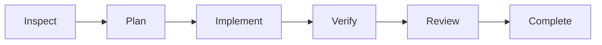

# Forge Agent

**Read, plan, and change code in a local browser, with verification and review evidence behind task completion.**

[简体中文](README.md) · English

[](https://github.com/sun-sh/forge-agent/actions/workflows/ci.yml)
[](https://nodejs.org/)
[](LICENSE)

Forge Agent is a local coding agent with a Web client as its primary interface. Projects, conversations, model selection, task progress, and Git diffs share one workspace. An optional command-line interface is also available.

It builds on the complete [Pi Coding Agent](https://github.com/earendil-works/pi) **1.4.0** runtime. Forge Agent adds task orchestration, working-mode policies, verification gates, Git change review, and Web interactions above Pi sessions. The current version is **0.1.0, in early development**.

## What you can do

- **Work by project:** expand, search, and reopen project history; retain drafts; inspect changed files and diffs.
- **Choose how to work:** Agent implements changes, Plan investigates and proposes a plan, and Ask reads code to answer questions. Select the project, mode, model, and reasoning effort below the composer.
- **Connect your models:** add a compatible provider in settings, discover models with a searchable multi-select, or enter model IDs manually. Test an actual model invocation before using it.
- **Inspect completion evidence:** use the planned workflow for complex tasks, with visible investigation, planning, implementation, verification, and review stages.

## Quick start

Install Git and **Node.js >= 22.19.0**, and have access to a model service. Remote services usually need an API key; compatible local services can use the explicit no-key option.

```bash
git clone https://github.com/sun-sh/forge-agent.git
cd forge-agent
npm ci
npm run build
npm start
```

`npm start` launches the local gateway and opens your default browser on port `4317`. Normal startup handles browser authorization automatically. To use another port, run `npm start -- --port 4328`. Installation is currently from source; an npm package and desktop installer have not been published.

For your first task:

1. Open **Settings → Service → Add service** (`设置 → 服务 → 添加服务`). Enter a name, Base URL, API protocol, and API key, or explicitly select the no-key option for a local service.
2. Fetch the model list and select models in the searchable checkbox dropdown. Enter IDs manually if the provider has no listing endpoint. Run an actual invocation test, then save the service.
3. Select a project, model, and supported reasoning effort below the composer. Saving a service and switching the active conversation's model are separate actions.
4. Inspect the project and its verification commands, then confirm project trust in settings. Configure `forge-agent.json` as described below to use the verification gate.
5. Choose a working mode, describe the task, and send it. For a complex change, select **Plan and execute** (`计划并执行`) in Agent mode.

The provider editor supports APIs compatible with **OpenAI Chat Completions, OpenAI Responses, and Anthropic Messages**. Services such as Ollama and LM Studio need to expose a compatible endpoint. Capabilities come from the catalog or explicit configuration; reasoning levels are not inferred from model names. The Web interface is currently in Chinese.

## Working modes and workflows

The working mode controls which tools may run:

| Mode | Purpose | Available tools |
| --- | --- | --- |
| **Agent** | Implement changes, run commands, and verify the project | Tools enabled by Pi configuration and project trust |
| **Plan** | Read the project and propose an implementation plan | Built-in read/search tools only |
| **Ask** | Understand code, explain behavior, and answer questions | Built-in read/search tools only |

Plan and Ask enforce restrictions on actual tool calls, blocking shell, writes, MCP/custom tools, slash-command dispatch, and automatic verification. Modes persist with the session and cannot change during a run. These policies restrict model-driven operations; trusted extension code still has the launching user's permissions.

Agent mode offers two workflows:

- **Direct conversation** (`直接对话`): use Pi's interaction loop for everyday questions and changes, with configured verification.
- **Plan and execute** (`计划并执行`): a Forge Agent controller advances through the stages below, while Pi executes every model and tool turn.



The planned workflow's completion gate requires passing configured verification, a structured `ready` review with no unresolved issues, and no detected changes during review within the available Git evidence. Verification failures receive at most `verifyRetries` automatic repairs. Review findings, missing checks, invalid review output, or stale evidence leave the task needing attention.

Stopping a task prevents later stages. After a service restart, unfinished work is marked interrupted. **Re-inspect and continue** (`重新检查并继续`) explicitly starts a fresh inspection of the current workspace. The model review is a second pass and can still miss defects.

## Agent design and ownership

Forge Agent places product behavior above Pi sessions, with explicit responsibilities:

| Layer | Responsibility and implementation |
| --- | --- |
| **Task controller** | [src/task/controller.ts](src/task/controller.ts): phase transitions, bounded repair, stop/resume, branch-persisted task state, and completion gates. |
| **Verification and evidence** | [src/verification/](src/verification/) and the [command executor](src/tools/command.ts): exact output, timeouts, child-process tree termination, and per-run reports. |
| **Working-mode policy** | [src/web/modes.ts](src/web/modes.ts): a Pi extension constrains actual tool calls, including nested and dynamically activated tools. |
| **Git review** | [src/task/git.ts](src/task/git.ts): staged, unstaged, and untracked changes; bounded diff previews; pre-existing change labels and status fingerprints. |
| **Web product layer** | [src/web/](src/web/): provider settings, project sessions, streaming, reconnect recovery, drafts, task progress, and change panels. |
| **Underlying runtime** | Pi: agent loop, model calls and authentication, tools, sessions and compaction, project trust, MCP, skills, extensions, and resource discovery. |

The implementation keeps one agent loop. The CLI delegates to Pi's entry point; the Web gateway creates sessions through Pi's SDK. The task controller owns stages and decisions, and Pi executes each model/tool turn. Earlier custom prototypes remain in `archive/prototype/`, outside the active build, tests, and supported feature set.

See [architecture and capability boundaries](docs/architecture.md) and the [UI design notes](docs/ui-design-notes.md) (Chinese).

## Configure project verification

Create `forge-agent.json` in the target project root. `forge-agent.yaml` and `forge-agent.yml` are also supported. Replace these commands with the checks your project actually uses:

```json
{
  "verify": [
    { "name": "typecheck", "command": "npm run typecheck", "timeoutMs": 120000 },
    { "name": "test", "command": "npm test", "timeoutMs": 300000 }
  ],
  "verifyRetries": 2
}
```

- Only `verify` and `verifyRetries` are accepted. Unknown fields are errors. The [JSON Schema](forge-agent.schema.json) defines the full constraints.
- Verification commands run only after Pi trusts the project.
- Exact failed command output is returned to the model, with at most `verifyRetries` repair attempts. Internal continuations do not reset the budget. Persistent check failure produces a nonzero CLI exit status.
- Timeouts and command-start failures also produce failed reports. Cancellation retains partial output and stops further checks and automatic repairs. Starting a new verification invalidates an older passing result.
- Per-workspace and per-run reports live under `FORGE_AGENT_HOME/verification`, with outcomes also recorded in the Pi session branch. The Web client displays associated verification and review evidence.

## Optional command-line entry points

Run `npm link` once from the source directory if you want the command on your PATH:

```bash
forge-agent web                            # Start the Web client
forge-agent                                # Pi's interactive terminal interface
forge-agent doctor                         # Inspect local setup without printing credentials
forge-agent check                          # Run the current project's configured checks
forge-agent -C path/to/project -p "Fix the failing tests"
```

The Web API-key editor covers common compatible services. Provider OAuth still uses `/login` in the terminal interface. Pi manages advanced MCP, skill, and extension configuration; the Web client uses the same local configuration.

## Validation and development

| Command | What it checks |
| --- | --- |
| `npm run check` | Type checking, active regression tests, build, and CLI/bin integration. |
| `npm run test:web` | A real Chromium browser against a local fixture model: provider setup, session recovery, task progress, Git diffs, and narrow layouts. |
| `npm run eval:smoke` | Two fixed tasks with scripted solutions, executed through actual Pi tools and workflows, then checked with independent assertions, file-change checks, and completion checks. |
| `npm run eval:agent -- --model provider/model --workflow planned` | The same task set with a configured real model. Sends task content to the provider and incurs its usage charges. |

Browser acceptance needs Edge, Chrome, or Chromium; set `FORGE_AGENT_TEST_BROWSER` to another executable if necessary. It uses a temporary project, isolated data directory, and browser profile. See [evaluation](docs/evaluation.md) for methods, output paths, and limits. Changes to completion, retry state, trust, persistence, or security require regression tests; follow [AGENTS.md](AGENTS.md).

## Local data and security

| Data | Default location |
| --- | --- |
| Configuration, models, and authentication | `~/.forge-agent`, overridden by `FORGE_AGENT_HOME` |
| Sessions | `FORGE_AGENT_HOME/sessions` |
| Verification evidence and raw output | `FORGE_AGENT_HOME/verification` |
| Local gateway access credential | `FORGE_AGENT_HOME/web/access-token` |

Legacy `PFORGE_HOME`, `~/.pforge`, and `pforge.json/yaml/yml` remain compatible. New `forge-agent.*` configuration takes precedence in the same directory. Existing sessions retain compatible storage identifiers.

The Web gateway binds to `127.0.0.1` by default, uses a local access credential and an HttpOnly, SameSite=Strict cookie, and checks Host and Origin. Model API keys are stored through Pi's authentication API; the editor does not return them or store them in browser storage.

Local operation describes where the client, process, and data live. With a remote model, relevant content is still sent to your configured provider. Agent tools, trusted extensions, and verification commands have the launching user's OS permissions. Project trust is not an OS sandbox; use a container, VM, or restricted account for untrusted projects. Sessions and raw logs can contain sensitive data, so inspect them before sharing. See [security notes](SECURITY.md).

## Current scope and next priorities

The current release is intended for local use, development, and early feedback. The Web interface is in Chinese, and further work includes:

- Web management for MCP, advanced provider settings, and diagnostics; OAuth and some resource management currently use Pi's TUI/configuration.
- Session archive, fork, export, and background tasks, plus file references and attachment input.
- Real-model evaluation on larger repositories, comparing direct and staged workflows for success rate, latency, and cost.
- Keyboard accessibility, installation, upgrades, and desktop distribution. No npm package, GitHub Release, or desktop installer has been published.

See the [product audit](docs/product-audit.md) (Chinese) for the full status and priorities. Report issues with sanitized reproductions through [Issues](https://github.com/sun-sh/forge-agent/issues), or contribute within the boundaries above.

## License and acknowledgments

[MIT License](LICENSE). Thanks to [Pi](https://github.com/earendil-works/pi) for the coding-agent runtime and to the project's open-source dependencies.
