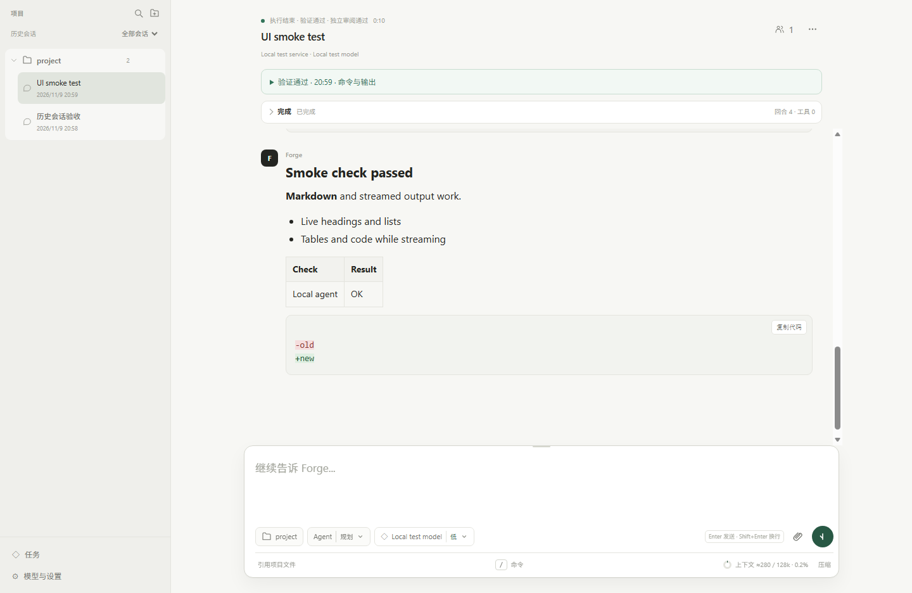
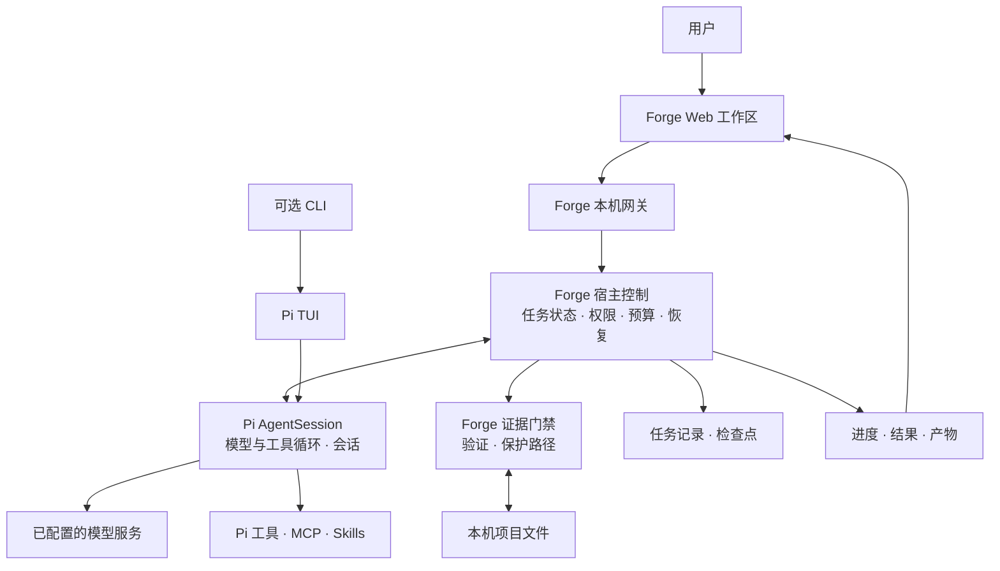

# Forge Agent

**在本机完成编码任务，让修改、验证和中断恢复都有可核对的记录。**

简体中文 · [English](README.en.md)

[](https://github.com/sun-sh/forge-agent/actions/workflows/ci.yml)
[](LICENSE)

Forge 是一个以 Web 工作区为主的本机 coding agent。连接你配置的模型，打开项目后即可对话、编辑文件、运行工具和检查 Git 差异。

Forge 基于 **Pi Coding Agent 1.4.0** 构建，Pi 负责模型与工具循环。项目重点不是另写一套 Agent Runtime，而是做好本机编码任务的宿主层：任务状态与恢复、基于当前证据的验证和保护门禁，以及围绕这些流程的 Web 工作区。



*真实 Edge 验收截图，使用隔离的本地模拟服务；临时目录路径已移除。它展示界面，不代表模型编码成绩。[30 秒截图导览](docs/assets/walkthrough.gif)。*

## 快速启动

准备 Git、Node.js **>= 22.19.0** 和一个可用的模型服务：

```bash
git clone https://github.com/sun-sh/forge-agent.git
cd forge-agent
npm ci
npm run build
npm start
```

启动后自动打开默认浏览器，本机默认地址为 `http://127.0.0.1:4317/`。

1. **设置 → 服务 → 添加服务**：填写协议、Base URL 和 Key，获取并批量选择模型，或手填模型 ID；测试后保存。本机免 Key 服务也可显式配置。
2. 在聊天框下方选择模型、推理强度和 **Agent / Plan / Ask**。Agent 默认自适应执行；只有明确选择二级菜单中的“规划并执行”才启用阶段控制。
3. 选择已有项目，或直接发送首条消息，Forge 会在自己的项目目录中创建独立文件夹。回形针、拖放和粘贴可提供图片、代码或文本附件。

兼容 OpenAI Chat Completions、Responses 和 Anthropic Messages 接口。当前 Web 界面为中文；完整设置与协议边界见[使用指南](docs/usage.md)。终端入口由 Pi 提供，可在源码目录运行 `npm link` 后使用 `forge-agent`。

## 文档与入口

| 你要做什么 | 从这里开始 |
| --- | --- |
| 安装、配置与日常使用 | [中文指南](docs/usage.md) · [English guide](docs/usage.en.md) |
| 中文阅读项目结构 | [架构深读（中文）](docs/architecture-deep-dive.md) |
| 中文阅读安全与验证 | [结果语义（中文）](docs/task-results.md#中文) · [中文安全说明](docs/security.zh.md) |
| English technical references | [Architecture map](docs/architecture.md) · [SECURITY.md](SECURITY.md) |
| 配置验证、运行与恢复 | [结果语义](docs/task-results.md) · [运行手册](docs/operations.md) |
| 查看评测结论和完整目录 | [评测中文摘要](docs/evaluation.md#中文摘要) · [全部文档与历史报告](docs/README.md) |

## 项目重点与代码结构

Forge 的 Agent 工程工作集中在 Pi 上方的宿主控制层，而不是模型推理或工具循环本身：



一次 Web 请求由 Forge 建立宿主任务并交给 Pi 执行模型/工具回合；Forge 再根据当前工作区、验证输出和保护路径证据管理状态与恢复。CLI 则直接使用 Pi 的 TUI，并接入 Forge 的验证扩展。下方代码表对应图中的主要模块。

| 目录 / 文件 | 职责 |
| --- | --- |
| `src/pi-cli.ts` | CLI 入口；接入 Pi TUI、身份与验证扩展 |
| `src/web/server.ts`、`src/web/` | 本机 Web 网关、API、项目/会话/Provider 适配和执行生命周期 |
| `src/web/ui/` | 浏览器客户端：聊天、历史会话、设置、工作区与任务进度 |
| `src/task/` | 宿主任务状态、阶段编排、队列、预算、持久化、检查点和子任务 |
| `src/verification/` | 项目检查、受保护路径和当前版本证据门禁 |
| `src/tools/command.ts` | 验证和本机终端共用的有界命令执行器 |
| Pi Coding Agent SDK | 模型/工具回合、Provider、会话、压缩、MCP、Skills 与资源发现 |

中文读者可从[架构深读](docs/architecture-deep-dive.md)了解组件关系、任务流程和设计取舍；上方代码表给出源码定位。简明组件总览另有[英文版](docs/architecture.md)。

## 核心行为

| 需要 | Forge 的处理 |
| --- | --- |
| **检查可交付性** | 配置验证绑定工作区和规则指纹；保护文件变化即使测试通过也会失败。历史通过与当前通过分开展示。 |
| **可选的规划闭环** | 调研同时产出简短计划，缺失时才补独立规划；实现后验证并独立审阅，附有界历史命令回执，修复后聚焦复查；约束与验收完整保留，模型推断不增加用户要求。 |
| **中断后继续** | 保留 Pi 会话与当前文件，从有效的已保存阶段继续；不重复追加原始请求，不自动重放工具调用。验证/审阅阶段恢复先重新验证。 |
| **交付文件可见** | 任务卡列出 Forge 观察到的文件工具写入/修改，可点击打开；shell 创建的文件目前不保证进入交付清单，可在右侧“文件”面板浏览。 |
| **紧凑的可视化** | 项目组织会话与分支，用户消息靠右，过程默认折叠；右侧查看差异、文件、终端与执行历史，聊天框旁展示暂停原因。 |
| **会话独立、按需引用** | 后台任务运行时可切换其他会话或新建对话；模型、推理强度和模式选择按会话暂存，下一条消息生效。明确要求引用同项目旧对话时，可检索并分段读取来源；不自动合并历史。 |
| **受控的并行工作** | 最多 3 个不同项目排队并行；子 Agent 可只读探索/审阅，worker 在独立 worktree 提出补丁，主项目由用户审阅应用并验证。 |

规划与独立审阅是显式选择的实验流程，默认保持自适应。Reviewer 标准上限为 5 分钟、24 回合、120 次工具、32,000 生成 token 和设定的 4 美元；扩展档需显式选择。预算耗尽、证据不足和具体缺陷分别处理；审阅不等于外部验收。中文状态说明见[审阅结果](docs/review-outcomes.md#中文)，实测结论见[评测摘要](docs/evaluation.md#中文摘要)。

网页搜索与网址正文读取默认可用，无需搜索 API Key；在 **设置 → 工具** 中开关并测试实际文档连接。回复保留来源网址；需要交互或登录的动态网页使用浏览器 MCP。模型管理、MCP、Skills、上下文压缩和分层参考记忆均可在界面管理。普通 worker 无 shell、MCP 或嵌套委派，适合有界文件任务；它不是独立全功能团队。[子 Agent 设计](docs/subagents.md)说明权限、预算及提案边界。

已配置 `verify` 的 Planned 任务会在实现前设计、运行冻结检查并保留基线，再执行验证和审阅；检查设计、环境或模型判断仍可能失败。两项固定补丁实验均未证明 reviewer 的通用检出收益，边界假设也未获资格验证。检查规则、调用诊断与失败报告见[完整文档目录](docs/README.md)。

## 配置验证与保护路径

在目标项目根目录创建 `forge-agent.json`（也支持 YAML）：

```json
{
  "verify": [
    { "name": "typecheck", "command": "npm run typecheck", "timeoutMs": 120000 },
    { "name": "test", "command": "npm test", "timeoutMs": 300000 }
  ],
  "verifyRetries": 2,
  "protect": ["tests", "package-lock.json"]
}
```

只接受 `verify`、`verifyRetries`、`protect`，未知字段报错。命令需要项目信任；失败输出原样返回模型，失败不能以成功退出。`protect` 接受字面的项目相对文件/目录，执行前的用户脏改动是保护基线；变化或无法完整观察都阻止交付。详情见 [Schema](forge-agent.schema.json) 与[使用说明](docs/usage.md)。

实现结束统一显示“已实现 · 需求未验收”（API：`result.status=implemented_unverified`）。“配置检查通过”与“独立模型审阅通过”各自只说明已有证据，均不冒称需求已解决。历史检查过期时重新显示待检查；未验收不会自动重跑任务。执行生命周期与验收声明、API 兼容和评测口径见[结果语义](docs/task-results.md)。

未配置命令时不宣称验证通过，实现结束显示“已实现 · 需求未验收 · 未配置自动验证”。模型主动调用 run_verification 与宿主检查使用同一跳过状态，空检查报告不会把任务误留在待验证；任务卡列出写入或修改的文件。配置了验证命令的规划流程仍需要当前版本的验证证据；只读 Plan 阶段不会弹出无关的跳过验证提示。

Web 对单条模型回复触及最大输出（含只有思考、没有正文或工具调用）做单独处理：通过 Pi 结束边界最多续接两次，仍受同一任务预算限制；再次失败停在实现阶段并报告真实原因。继续旧记录时会重新进入未完成的实现，避免空输出被误送去验证。

## 长任务与本机数据

新安装单段默认 90 分钟、240 模型回合、500 工具调用、300,000 生成 token，累计请求 token 默认只统计，费用上限 $40。**设置 → 关于 → 执行预算** 提供四小时长任务预设，保留原费用上限，保存后在下一次执行或继续时生效；已有配置不被覆盖。

达到上限会保存状态并说明原因；点击继续开启新的有界用量段，目标、保护基线和已用修复次数保留。后台运行见[运行与恢复](docs/operations.md)。

数据默认在 `~/.forge-agent`，支持 `FORGE_AGENT_HOME` 及旧 `PFORGE_HOME` / `~/.pforge`。新项目集中管理，主动打开的外部文件夹在原位置工作。远程模型仍会收到相关内容；Agent、MCP、扩展和命令拥有启动者系统权限，信任与 worktree 都不是 OS 沙箱。中文边界见[使用指南本机安全章节](docs/usage.md#本机数据与安全)；更完整的策略为英文版 [SECURITY.md](SECURITY.md)。

中文安全入口：[安全边界说明](docs/security.zh.md)。英文版 SECURITY.md 提供完整威胁模型和控制清单。

## 评测证据

评测结论目前是克制的：小样本真实任务没有证明 Planned 或独立 reviewer 能普遍提升交付质量，reviewer 资格实验也未达到预注册门槛。因此自适应执行仍是默认，规划与审阅保持实验性。[评测摘要](docs/evaluation.md#中文摘要)说明结果、限制和证据口径；完整历史档案按需查阅[文档目录](docs/README.md)。

[真实模型 GitHub 工作流](.github/workflows/swebench-real.yml)需要显式配置 Provider Secrets；[无 Key 补判](.github/workflows/swebench-regrade.yml)对保留补丁补判，不重跑模型。

```bash
npm run check
npm run test:web
npm run pack:check
npm run eval:smoke -- --workflow ablation
```

[GitHub v0.2.1](https://github.com/sun-sh/forge-agent/releases/tag/v0.2.1) 提供可安装的 tgz 与 SHA-256；下载并核对后，可用 `npm install -g ./forge-agent-0.2.1.tgz` 安装，再运行 `forge-agent web`。尚未发布 npm registry 或桌面安装器；发布流程见[运行文档](docs/operations.md)。欢迎提供脱敏复现或参与[贡献](CONTRIBUTING.md)。

[MIT License](LICENSE)。感谢 [Pi](https://github.com/earendil-works/pi) 和本项目使用的开源依赖。
