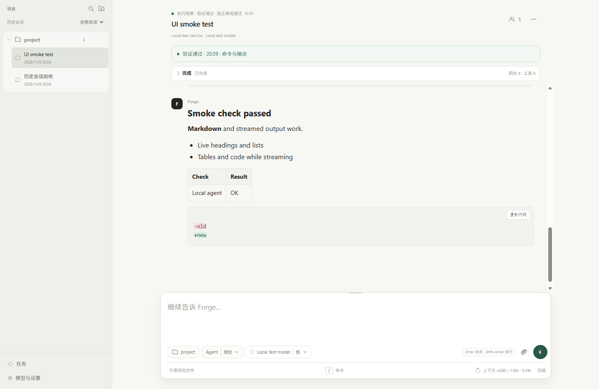

# Forge Agent

**在本机完成编码任务，让修改、验证和中断恢复都有可核对的记录。**

简体中文 · [English](README.en.md)

[](https://github.com/sun-sh/forge-agent/actions/workflows/ci.yml)
[](LICENSE)

Forge 是一个以 Web 工作区为主的本机 coding agent。连接你配置的模型，打开项目后即可对话、编辑文件、运行工具和检查 Git 差异。

Forge 关注的是交付边界：测试通过时，模型是否改坏了测试本身？任务中断后，能否保留目标、计划和已有工作继续？界面的“完成”是否真的有当前版本的证据？这些控制构建在 **Pi Coding Agent 1.4.0** 会话之上，Pi 继续负责模型与工具循环。



*真实 Edge 验收截图，使用隔离的本地模拟服务；临时目录路径已移除。它展示界面，不代表模型编码成绩。[30 秒截图导览](docs/assets/walkthrough.gif)。*

## 快速启动

准备 Git、Node.js **>= 22.19.0** 和一个可用的模型服务：

```bash
git clone https://github.com/sun-sh/forge-agent.git
cd forge-agent
npm ci
npm run build
npm start
```

启动后自动打开默认浏览器，本机默认地址为 `http://127.0.0.1:4317/`。

1. **设置 → 服务 → 添加服务**：填写协议、Base URL 和 Key，获取并批量选择模型，或手填模型 ID；测试后保存。本机免 Key 服务也可显式配置。
2. 在聊天框下方选择模型、推理强度和 **Agent / Plan / Ask**。Agent 默认自适应执行；只有明确选择二级菜单中的“规划并执行”才启用阶段控制。
3. 选择已有项目，或直接发送首条消息，Forge 会在自己的项目目录中创建独立文件夹。回形针、拖放和粘贴可提供图片、代码或文本附件。

兼容 OpenAI Chat Completions、Responses 和 Anthropic Messages 接口。当前 Web 界面为中文；完整设置与协议边界见[使用指南](docs/usage.md)。终端入口由 Pi 提供，可在源码目录运行 `npm link` 后使用 `forge-agent`。

## 核心行为

| 需要 | Forge 的处理 |
| --- | --- |
| **检查可交付性** | 配置验证绑定工作区和规则指纹；保护文件变化即使测试通过也会失败。历史通过与当前通过分开展示。 |
| **可选的规划闭环** | 调研同时产出简短计划，缺失时才补独立规划；实现后验证并独立审阅，修复后聚焦复查；约束与验收完整保留。 |
| **中断后继续** | 保留 Pi 会话与当前文件，从有效的已保存阶段继续；不重复追加原始请求，不自动重放工具调用。验证/审阅阶段恢复先重新验证。 |
| **交付文件可见** | 任务卡直接列出模型写入或修改的文件，Git 项目和普通文件夹都适用；点击即可在右侧文件面板打开，不需要手动寻找项目目录。 |
| **紧凑的可视化** | 项目组织会话与分支，用户消息靠右，过程默认折叠；右侧查看差异、文件、终端与执行历史，聊天框旁展示暂停原因。 |
| **会话独立、按需引用** | 后台任务运行时可切换其他会话或新建对话；模型、推理强度和模式选择按会话暂存，下一条消息生效。明确要求引用同项目旧对话时，可检索并分段读取来源；不自动合并历史。 |
| **受控的并行工作** | 最多 3 个不同项目排队并行；子 Agent 可只读探索/审阅，worker 在独立 worktree 提出补丁，主项目由用户审阅应用并验证。 |

网页搜索与网址正文读取默认可用，无需搜索 API Key；在 **设置 → 工具** 中开关并测试实际文档连接。回复保留来源网址；需要交互或登录的动态网页使用浏览器 MCP。模型管理、MCP、Skills、上下文压缩和分层参考记忆均可在界面管理。普通 worker 无 shell、MCP 或嵌套委派，适合有界文件任务；它不是独立全功能团队。[子 Agent 设计](docs/subagents.md)说明权限、预算及提案边界。

## 配置验证与保护路径

在目标项目根目录创建 `forge-agent.json`（也支持 YAML）：

```json
{
  "verify": [
    { "name": "typecheck", "command": "npm run typecheck", "timeoutMs": 120000 },
    { "name": "test", "command": "npm test", "timeoutMs": 300000 }
  ],
  "verifyRetries": 2,
  "protect": ["tests", "package-lock.json"]
}
```

只接受 `verify`、`verifyRetries`、`protect`，未知字段报错。命令需要项目信任；失败输出原样返回模型，失败不能以成功退出。`protect` 接受字面的项目相对文件/目录，执行前的用户脏改动是保护基线；变化或无法完整观察都阻止交付。详情见 [Schema](forge-agent.schema.json) 与[使用说明](docs/usage.md)。

未配置命令时不宣称验证通过，实现结束显示“已完成 · 未配置自动验证”。模型主动调用 run_verification 与宿主检查使用同一跳过状态，空检查报告不会把任务误留在待验证；任务卡列出写入或修改的文件。配置了验证命令的规划流程仍需要当前版本的验证证据；只读 Plan 阶段不会弹出无关的跳过验证提示。

Web 对单条模型回复触及最大输出（含只有思考、没有正文或工具调用）做单独处理：通过 Pi 结束边界最多续接两次，仍受同一任务预算限制；再次失败停在实现阶段并报告真实原因。继续旧记录时会重新进入未完成的实现，避免空输出被误送去验证。

## 长任务与本机数据

新安装单段默认 90 分钟、240 模型回合、500 工具调用、300,000 生成 token，累计请求 token 默认只统计，费用上限 $40。**设置 → 关于 → 执行预算** 提供四小时长任务预设，保留原费用上限，保存后在下一次执行或继续时生效；已有配置不被覆盖。

达到上限会保存状态并说明原因；点击继续开启新的有界用量段，目标、保护基线和已用修复次数保留。后台运行见[运行与恢复](docs/operations.md)。

数据默认在 `~/.forge-agent`，支持 `FORGE_AGENT_HOME` 及旧 `PFORGE_HOME` / `~/.pforge`。新项目集中管理，主动打开的外部文件夹在原位置工作。远程模型仍会收到相关内容；Agent、MCP、扩展和命令拥有启动者系统权限，信任与 worktree 都不是 OS 沙箱。见 [SECURITY.md](SECURITY.md)。

## 实现归属与证据

**Pi 负责**模型/工具循环、认证、内置工具、会话树、压缩、MCP 协议、Skills、扩展及资源发现。**Forge 负责**任务状态与交接、验证及保护门禁、预算/执行所有权、恢复、子任务生命周期和 Web 产品层；旧原型不属于活动构建。

[Architecture Deep Dive](docs/architecture-deep-dive.md)解释设计、取舍与限制；[评测方法与真实失败记录](docs/evaluation.md)区分回归、模拟服务和真实模型结果。评测器支持固定仓库 baseline/reference 验证、[SWE-bench Lite 评测准备](docs/evaluations/swebench-lite-2026-11-10.md)；[GitHub Docker smoke 已通过](docs/evaluations/swebench-lite-github-smoke-2026-11-11.md)（固定名单与官方 harness），仓库还提供需要 `FORGE_BENCHMARK_API_KEY` 和 `FORGE_BENCHMARK_BASE_URL` Secrets 的[真实模型 GitHub 评测工作流](.github/workflows/swebench-real.yml)。工作流停止与服务故障分开统计；可用[无 Key 补判](.github/workflows/swebench-regrade.yml)核对原始补丁，保留旧报告并单列已解决但未交付的次数。[最新 45 次 DeepSeek 实测](docs/evaluations/deepseek-current-ablation-2026-11-11.md)在当前代码上三组均通过 15/15，但没有观察到规划或审阅的质量提升；它同时记录了额外 token 和延迟。[五任务重复对照](docs/evaluations/five-task-ablation-2026-11-10.md)保留此前批次，[会话稳定性验收](docs/evaluations/conversation-stability-2026-11-10.md)覆盖导航与上下文引用；[工作流与审阅评测](docs/evaluations/focused-review-2026-11-10.md)分别记录自然任务的三组对照和正确/缺陷补丁的审阅漏检、误报与弃权；[旧故障注入诊断](docs/evaluations/review-challenge-2026-11-09.md)单独保留。关闭审阅仅限隔离评测，生产请求不能绕过门禁；当前样本仍不足以证明规划、审阅或记忆的通用收益。

```bash
npm run check
npm run test:web
npm run pack:check
npm run eval:smoke -- --workflow ablation
```

源码和 tgz 构建校验可用，尚未发布 npm registry 或桌面安装器；发布流程见[运行文档](docs/operations.md)。欢迎提供脱敏复现或参与[贡献](CONTRIBUTING.md)。

[MIT License](LICENSE)。感谢 [Pi](https://github.com/earendil-works/pi) 和本项目使用的开源依赖。
