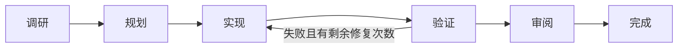

# Forge Agent

**连接你选择的模型，在本机浏览器中理解代码、修改项目，并检查执行结果。**

简体中文 · [English](README.en.md)

[](https://github.com/sun-sh/forge-agent/actions/workflows/ci.yml)
[](https://nodejs.org/)
[](LICENSE)

Forge Agent 是一个面向本机项目的开源 coding agent，以 Web 工作区为主要入口：左侧组织项目与会话，中间进行对话，右侧查看 Git 差异、项目文件和终端输出。你可以接入兼容的第三方或本机模型服务，管理 MCP、Skills 和分层记忆，也可以通过终端使用。

项目基于 [Pi Coding Agent](https://github.com/earendil-works/pi) **1.4.0** 的完整运行时构建。Forge 自己实现的重点是**任务编排、工具权限策略、验证门禁、执行证据和可恢复的 Web 交互**。当前版本为 **0.1.0**，从源码安装，适合本机开发和早期反馈。

[快速启动](#快速启动) · [设计与职责](#设计与职责) · [使用指南](docs/usage.md) · [架构](docs/architecture.md) · [评测](docs/evaluation.md)

## 快速启动

准备 Git、**Node.js >= 22.19.0**，以及一个可用的模型服务。

```bash
git clone https://github.com/sun-sh/forge-agent.git
cd forge-agent
npm ci
npm run build
npm start
```

`npm start` 启动本机网关并自动打开默认浏览器，默认端口为 `4317`，正常启动会自动完成浏览器授权。需要其他端口时使用 `npm start -- --port 4328`。

1. 打开 **设置 → 服务 → 添加服务**，填写 Base URL、协议和 API Key；兼容的本机服务可以明确选择免 Key。获取模型列表后批量选择，或手填模型 ID，再测试实际调用并保存。
2. 在聊天框下方选择模型、推理强度和工作模式。首次使用不需要先选文件夹：直接发送第一条消息，Forge 会在 `FORGE_AGENT_HOME/projects` 下创建独立项目；也可以打开项目选择器，主动创建项目或打开电脑上的已有文件夹。
3. 描述任务并发送，例如：**“修复登录接口失败的测试，保留现有 API，并运行项目验证。”** 需要自动验证时，先配置下文的 `forge-agent.json`。点击发送按钮旁的回形针图标添加图片、代码或文本文件，也支持拖放和粘贴图片。

服务编辑器支持兼容 **OpenAI Chat Completions、OpenAI Responses、Anthropic Messages** 的接口。Ollama、LM Studio 等本机服务需提供相应兼容接口。推理强度按模型能力显示；运行中选择的新模型与强度在下一条消息生效。

Web 模型选择器只提供在 Forge 数据目录中保存凭据或配置的服务模型；启动进程继承的其他应用环境凭据不会自动添加模型。`models.json` 中主动配置的环境变量引用仍受支持。

## 工作区与能力

| 场景 | 当前支持 |
| --- | --- |
| **围绕项目工作** | Forge 项目目录和主动打开的本机目录统一出现在项目列表，支持移除并通过重新打开文件夹恢复；按项目组织会话，搜索、重命名、置顶、归档、回收站与恢复；编辑消息建立分支，导出 Markdown / JSON。 |
| **检查修改** | 右侧 Git 文件列表与 diff、项目文本搜索/预览、用户输入的终端命令；标记任务开始前已有的修改。 |
| **提供上下文** | 引用项目文本文件；上传图片、UTF-8 文本或代码文件；管理全局/项目/会话参考记忆；输入框下方显示上下文与 Pi 压缩状态。 |
| **连接模型与工具** | 第三方服务配置、模型发现与批量选择；MCP 配置、连接测试、浏览器 OAuth 和工具设置；Skills 预览、启停与本机目录导入。 |
| **跟踪与恢复任务** | 规划任务的阶段、验证输出、审阅记录和持久化任务索引；服务重启后标为中断，由用户明确重新检查并继续。 |
| **子 Agent 协作** | 主 Agent 可按需并行委派探索和审阅，子任务使用独立 Pi 会话；标题旁查看状态、用量与耗时，右侧查看过程、单独停止，结果返回主 Agent 汇总。 |

文件引用和预览会检查路径、已知敏感文件名、符号链接及大小；图片还会检查格式和总量。它们是 Web 功能的访问边界，不能替代进程隔离。

### 工作模式

| 模式 | 行为 |
| --- | --- |
| **Agent** | 使用 Pi 的工具完成修改与执行；默认采用自适应流程。 |
| **Plan** | 只读调研并提出计划；由用户切换到 Agent 后实现。 |
| **Ask** | 只读理解代码和回答问题。 |

Plan / Ask 的限制落实到实际工具调用，包含动态或嵌套调用；允许内置读取与搜索，阻止写入、shell、MCP/自定义工具和自动项目验证。可信扩展代码仍拥有启动者权限。

### 执行流程

**自适应是默认流程**：Pi 执行模型与工具回合，模型按任务安排步骤，Forge 在配置了检查时执行验证门禁。

只有在 Agent 的二级菜单中手动选择 **规划并执行**，Forge 才会启用阶段控制。需要修改代码的任务按以下流程推进：



完成门禁要求配置的验证通过、结构化模型审阅为 `ready` 且没有遗留问题，并在可用的 Git 证据范围内未检测到审阅期间的变更。缺少检查、审阅无效或证据过期会进入需要处理的状态。问答和纯验证请求会走较短路径。

这是一种可检查的执行机制；额外规划与模型自审的收益仍需实测。验证修复次数和每次执行的时间、模型回合、工具调用、token 与费用预算都有上限，预算耗尽会进入可恢复的“达到执行预算”状态。

### 子 Agent

复杂任务中，主 Agent 可以通过 `subagent` 工具一次委派最多 3 个只读探索或审阅任务；简单问题仍直接回答。每个子任务有独立上下文，继承委派时的模型与推理强度，可以读取和搜索文件，不可写入、执行命令、调用 MCP 或继续委派。主 Agent 等待这批任务返回后汇总结论，也可带原子任务 ID 续问。阶段流程中的模型自审仍是原来的门禁，不会自动变成多 Agent 审阅。

有子任务时，会话标题旁才显示入口；展开列表查看状态、耗时和 token，点击任务在右侧查看记录或停止。子会话保存在独立目录，不会挤占普通会话历史。停止父任务会停止子任务并等待清理；重启后尚未完成的子任务标为中断，不自动重放。并行写入、Git worktree 隔离、子任务独立模型设置以及直接在子面板发消息尚未支持。

### 执行预算

Web 设置中的 **关于 → 执行预算** 控制每次 Agent 执行（包括自适应和规划并执行）的上限，默认是 15 分钟、50 个模型回合、300 次工具调用、750,000 个 token 和 25 美元。预算状态会随任务写入会话和任务索引；调整设置后可以重新检查失败或预算耗尽的任务。Provider 用量通常在一轮响应结束时才能取得，因此单轮响应可能略微超过阈值，不能把它当作账单级硬隔离。

子任务的回合、工具与模型用量同时计入父任务总预算；每次子任务激活额外限制为最多 3 分钟、12 个模型回合、60 次工具调用、120,000 token 和 2 美元，且不能超过父任务的对应上限。单次用户请求最多委派 12 次（包含对子任务的续问）。

## 设计与职责

Forge 在 Pi 会话之上实现产品与控制层，复用 Pi 的模型/工具循环，不重新实现一套运行时。

| Forge 实现 | 解决的问题 | 代码 |
| --- | --- | --- |
| **任务状态机与恢复** | 阶段转换、停止、有限修复、任务发现与中断后重新检查；Pi 会话保存对话与任务记录。 | [任务控制器](src/task/controller.ts)、[任务索引](src/task/registry.ts) |
| **子任务生命周期** | 独立 Pi 会话、受限工具、并行容量预留、父子预算、结果回收、停止联动及归属验证。 | [子 Agent 管理](src/web/subagents.ts)、[设计说明](docs/subagents.md) |
| **执行所有权与预算** | 同一 home 只允许一个 Web owner；同一项目的 Agent、终端和信任变更互斥；执行有时间、回合、工具、token 和费用边界。 | [Home 租约](src/task/registry.ts)、[项目执行](src/web/executions.ts)、[预算](src/task/budget.ts) |
| **验证与执行证据** | 保留原始失败输出、限制修复次数、执行超时、终止子进程树；失败不能作为成功完成。 | [验证扩展](src/verification/pi-extension.ts)、[命令执行器](src/tools/command.ts) |
| **工具权限策略** | 在运行时约束只读模式，防止仅隐藏界面入口而仍可执行工具。 | [模式策略](src/web/modes.ts) |
| **变更与上下文适配** | Git baseline、变更指纹、受限 diff；用户维护的三层参考记忆与安全文件引用。 | [Git 证据](src/task/git.ts)、[记忆](src/web/memory.ts)、[文件引用](src/web/files.ts) |
| **Web 产品层** | 流式输出、事件重连、历史分支、模型/MCP/Skills 管理与执行结果展示。 | [Web 网关与界面](src/web/) |

**Pi 负责** Agent loop、模型调用与认证、内置工具、会话树、压缩、项目信任、MCP 协议与执行、Skills、扩展和资源发现。Forge 的 MCP 管理复用 Pi 的协议和授权能力，终端界面也由 Pi 提供。

分层记忆目前是用户维护、按作用域注入的参考资料；项目记忆按规范化真实目录身份隔离，并兼容迁移旧文件；自动压缩由 Pi 负责。自动经验提取、检索排序和记忆质量评测属于后续工作。旧原型位于 `archive/prototype/`，不属于当前构建或受支持能力。

## 配置验证

在目标项目根目录创建 `forge-agent.json`，也支持 YAML。将命令替换为项目实际使用的检查：

```json
{
  "verify": [
    { "name": "typecheck", "command": "npm run typecheck", "timeoutMs": 120000 },
    { "name": "test", "command": "npm test", "timeoutMs": 300000 }
  ],
  "verifyRetries": 2
}
```

配置只接受 `verify` 与 `verifyRetries`，未知字段会报错。项目必须经过 Pi 信任才会执行检查；失败原始输出会反馈模型，内部自动继续不会重置修复次数。持续失败时，CLI 以非零状态退出。验证结果写入 Pi 会话分支，原始输出和报告保存在 `FORGE_AGENT_HOME/verification`。

详见 [JSON Schema](forge-agent.schema.json)。需要终端入口时执行 `npm link`，再使用 `forge-agent`、`forge-agent check` 或 `forge-agent -p "任务"`。

## 开发与评测

| 命令 | 用途 |
| --- | --- |
| `npm run check` | 类型、活动回归测试、构建和 CLI/bin 检查。 |
| `npm run test:web` | 在真实 Edge / Chrome / Chromium 中，使用本地模拟模型验收 Web 交互。 |
| `npm run eval:smoke` | 使用预设解答检查工具执行、工作流与评测链路。 |
| `npm run eval:agent -- --model provider/model --workflow direct` | 使用已配置的真实模型运行固定任务集；启动前会检查模型认证，并将模型目录与凭据复制到隔离评测 home。 |
| `npm run eval:agent -- --model provider/model --workflow planned` | 同一任务集走规划流程，用于与直接执行对照。 |
| `npm run eval:agent -- --model provider/model --workflow both --repeat 3` | 在固定模型设置下重复运行两种流程，比较通过率、耗时、修复、token 和费用。 |

评测默认在隔离的临时 Forge home 与工作区运行，也可以用 `--home` 指定可审查的位置。真实评测默认从当前 Forge home 读取配置；需要指定来源时使用 `--config-home <路径>`。评测只复制 `models.json` 与 `auth.json`，不会复用源会话、任务或 MCP 状态；启动预检发现模型不可用时会在第一个任务前失败。它会检查独立断言、受保护文件、验证结果和完成状态，并记录 Git revision、suite fingerprint、耗时分位数、修复、工具调用、token、费用与 Pi 统计；执行预算统计还会包含受控子 Agent 的用量。当前公开任务集包含五个小型函数修复任务，其中两个覆盖跨文件修改；尚未提供复杂仓库的真实模型对照结果。回归测试、浏览器验收和预设解答都不能证明模型编码水平。方法与输出格式见 [评测说明](docs/evaluation.md)。

## 当前边界

- **运行与交付**：本机 Web 客户端与可选终端入口；Web 界面目前为中文。尚未发布 npm 包、桌面安装包或独立后台队列。
- **并发与恢复**：同一个 `FORGE_AGENT_HOME` 只允许一个 Web 服务 owner；Agent、终端和项目 Trust 变更共享规范化项目锁，任务索引写入失败会在任务 API 中显示诊断。暂未提供独立的后台队列，运行中的任务仍由本机网关持有。
- **兼容性**：Provider OAuth 仍走终端 `/login`；外部 MCP / OAuth、企业代理与第三方模型参数需逐项验收。
- **工程重点**：真实仓库 direct/planned 对照、Provider/MCP 兼容性、记忆检索质量、可控撤销、诊断与分发仍需继续验证；当前版本没有宣称行业领先或真实编码质量已被证明。

已复现的问题、影响范围与验收要求记录在 [产品审查](docs/product-audit.md)。

## 数据与安全

数据默认保存在 `~/.forge-agent`，可用 `FORGE_AGENT_HOME` 指定；旧 `PFORGE_HOME`、`~/.pforge` 和 `pforge.json/yaml/yml` 保持兼容。Forge 不会把服务启动目录自动当成首个项目。

Forge 管理的新项目位于 `FORGE_AGENT_HOME/projects`，项目索引位于 `FORGE_AGENT_HOME/web/projects.json`。主动打开电脑上的外部文件夹时，Forge 只保存规范化路径并在原位置工作，不移动或复制项目；无项目发送首条消息时才会按需创建目录。所有 Pi 会话仍统一保存在 `FORGE_AGENT_HOME/sessions`，所以项目、会话和分支可以在本机统一管理。

Web 网关默认绑定 `127.0.0.1`，使用本机访问凭证、HttpOnly / SameSite Cookie 及 Host / Origin 检查。模型 Key 通过 Pi 认证 API 保存，不返回编辑器或写入浏览器存储。

本机运行指客户端和执行进程的位置；使用远程模型时，相关内容仍会发送到所选服务。Agent、MCP、可信扩展与验证命令拥有启动者的操作系统权限，项目信任不是 OS 沙箱。会话和日志可能包含敏感信息，分享前应检查。详见 [安全说明](SECURITY.md)。

## 文档与贡献

- [使用指南](docs/usage.md)：模式、命令、上下文、记忆、Skills、MCP、会话与本机数据。
- [架构与职责](docs/architecture.md)：Pi 与 Forge 的实现边界。
- [MCP 管理](docs/mcp-management.md) · [评测方法](docs/evaluation.md) · [产品审查](docs/product-audit.md)。
- [开发约定](AGENTS.md)：完成状态、重试、信任、持久化和安全变更须补回归测试。

欢迎在 [Issues](https://github.com/sun-sh/forge-agent/issues) 提交脱敏的复现步骤，或围绕上述范围贡献改进。

## 许可与致谢

[MIT License](LICENSE)。感谢 [Pi](https://github.com/earendil-works/pi) 及本项目使用的开源依赖。
