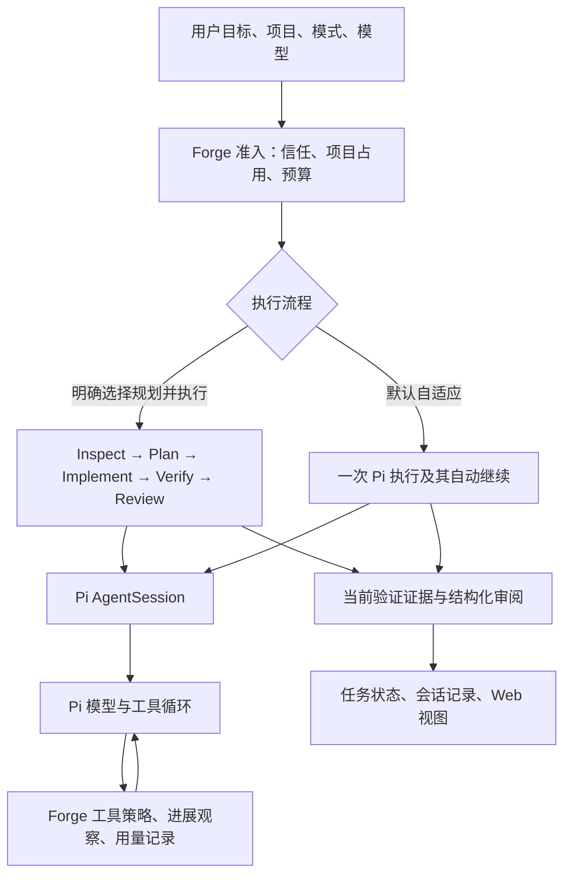
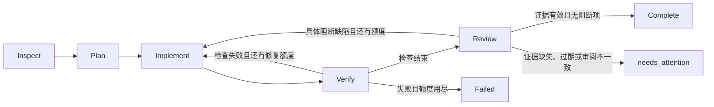

# Architecture Deep Dive

Forge Agent 的设计重点是：在成熟的模型与工具运行时上，让一次编码任务的执行、完成判定、权限、持久化与恢复可以被检查。本文对应活动源码；`archive/prototype/` 不属于当前实现。组件职责总表见 [architecture.md](architecture.md)。

本文的阶段调度、任务中心、子 Agent 和记忆交互对应 Web 客户端。CLI 使用 Pi TUI 与 Forge 验证扩展，尚不具备全部 Web 任务管理能力。

## 1. 两层循环，以及为什么保留 Pi

Forge 固定使用 Pi Coding Agent / Pi AI 1.4.0。Pi 负责模型请求、工具分发、自动继续、会话树、压缩、认证、MCP 和资源发现。Forge 负责用户任务的宿主状态、阶段策略、验证门禁、预算、项目执行所有权和 Web 交互。

两层循环处理不同的问题。Pi 决定一次模型执行何时调用工具和继续；Forge 决定宿主任务处于哪个阶段、哪些操作允许、何时运行项目验证以及是否具备完成证据。Forge 的 `TaskController` 不调用 provider，也不自行 dispatch 工具。

选择成熟运行时减少协议、流式工具参数、会话分支和 provider 兼容方面的重复工作。代价是依赖 Pi 扩展事件的语义；例如异步孩子的汇总依赖 settlement 边界。因此必须固定 SDK 版本，并用真实 Pi 会话的本机测试覆盖这些集成边界。升级 SDK 不能只看类型检查。

源码：[任务控制器](../src/task/controller.ts)、[Pi 验证扩展](../src/verification/pi-extension.ts)、[Web 适配器](../src/web/server.ts)。

## 2. 规划、执行与反思的边界

默认自适应保留短路径，普通问答不强制增加 Planner、Reviewer 模型调用。用户明确选择“规划并执行”后，变更任务采用以下状态机：

`TaskAdapter` 分开提供执行、验证、证据复核和 Git 观察能力。inspect 形成版本化 `brief`：目标、相关文件、完整约束、验收条件、未解决问题及任务理解；宿主同时生成独立的 `requirements` 账本，作为跨阶段和压缩的稳定交接，不让后续模型意图或计划覆盖它；宿主分配 `A1…` 编号。inspect 可在同一交接中返回有界 steps；宿主校验并直接派生 plan，省去一次额外模型调用。缺少 steps 的旧交接才进入独立 plan。宿主保留 requirements 的约束与验收，防止重新规划时静默遗漏。inspect/plan 的格式无效会在同一 Pi 会话里有界校正一次；将常规默认项当成阻塞时再复核一次，保留原目标、约束和验收。真实歧义或再次无效才停在只读阶段。交接 JSON 有整体大小上限，超过时需要更简洁的完整表达，不截断必需条件。implement 交还宿主后，宿主独立执行配置的检查。

Reflection 当前实现为结构化 review：`verdict`、`summary`、阻断 `issues`、非阻断 `notes` 及逐项 `acceptance` 依据。必须恰好覆盖全部验收 ID；遗漏、重复、凭空增加和 unconfirmed 都不能完成。无法解析、存在问题、工作区已变或验证未确认，同样不能取得完成状态。具体审阅缺陷可以进入修复，但与检查失败**共用** `verifyRetries`，自动继续、切换阶段或修复原因变化都不会重置额度。检查失败的原始输出交回 Pi，输出本身不获得指令权限。格式验证不能证明模型正确理解原始需求，仍需外部验收。

plan 和 implement 保持在父 Pi 会话中，以便继续使用同一项目上下文。review 阶段现在通过宿主专用的 `reviewGate` 启动一个全新的、只读的 Pi 子会话：只交付原始请求的有界摘要、完整结构化要求、验证结果和工作区实际文本补丁，不交付实施 transcript，也不接受语义上的续问。`review-evidence.ts` 从当前 Pi 分支派生最近实现阶段的有界内置命令回执，包含失败、原长度/哈希、截断与遗漏计数；不包含思考、普通正文或 MCP/custom 输出，不复制到计数快照。回执明确为历史且未绑定当前版本，不能替代配置验证；要求账本是模型解释而非新增用户约束。若第一次返回不符合 schema，宿主只在同一个 reviewer 会话中发送一次格式校正，并计入父预算；第二次仍无效就进入 `needs_attention`。它使用既有的受限子 Agent 生命周期、父预算和项目读权限；审阅记录保存独立 session ID、模型、交接版本/大小和 initial/repair 范围，门禁不能退回同上下文自审。`review-handoff.ts` 只发送一份完整要求账本，避免 brief/requirements/plan 重复；先检查完整补丁，仅针对缺失依赖读取项目。修复后的新 reviewer 同时接收前次阻断问题，复查修复及回归，但仍需覆盖全部原验收项。独立审阅仍是模型证据，不能替代外部验证或证明通用代码质量。

`mode`、`intentHint`、解析后的 `kind` 和验收条件分别记录。有限规则只作为遥测提示，不能选择阶段、授予权限或跳过实现。所有规划模式的用户请求先保持 `undetermined`，由只读 inspect 形成结构化理解；明确的宿主动作另行处理。结构化交接明确回答、探索、验证或澄清时才走相应短路径；缺少目标、实现验收或存在未解决问题就 needs_attention 等待澄清。自适应 Agent 不用提示推定 kind，保持 `undetermined` 并由 Pi 继续原生回合，避免提示绕过证据或待应用提案门禁。权限仍由用户模式、信任和工具策略决定，模型理解不能增加权限。

“应用并验证”是明确的宿主动作，直接携带内部 verify 意图，不从按钮描述文字反推行为；HTTP 用户提示和模型输出不能设置这个字段。交接解析兼容证据说明之后唯一的末尾 JSON，但仍拒绝多个对象、尾随指令和未知控制字段。该格式兼容性由真实模型的一次 needs_attention 失败推动，失败与修复后复跑分别记录。

真实仓库验收曾发现 `Extend … Run configured verification` 被误路由为纯验证，之后定向 review 又复现“请解决登录接口的 500 错误”“请把登录按钮变成蓝色”被当成 explore；这些都进入阶段行为回归。规则与结构化理解仍可能误判，尚不宣称通用意图理解。answer/explore 同样记录执行封套，避免短路径丢失工具活动和用量信息。

验收：[控制器](../tests/task-controller.test.ts)、[模式与路由](../tests/web-modes.test.ts)、[CLI 完成与重试](../tests/pi-e2e.test.ts)。

`shell-timeout.ts` 只在原生 bash / powershell 未传 timeout 时填入 120 秒，显式长命令超时不改。执行、流式输出、进程树终止和错误回传仍由 Pi 负责，不引入另一个 shell executor 或任务循环。真实模型验收曾在多行 Python shell 检查上卡住，该失败和修复后重跑须分别保留。

Web 的 `output-guard.ts` 在 Pi `agent_before_settle` 边界识别 `length` 和无正文/无工具的空结果，最多请求两次原会话续接，不另建模型/工具循环。失败保留在原阶段，不将“无文件、只有思考”的截断执行误当实现结束；父用量与取消仍由已有 Pi hooks 统计。旧记录已错误进入 verify 时，宿主依据最后模型 stopReason 恢复 implement。它不会提高用户配置的单次输出上限，也不暗中降低思考档位。

### 公共联网工具

Forge 通过具名 Pi 扩展注册 `web_search` / `web_fetch`，没有额外的模型或工具循环。正文提取复用 Mozilla Readability / LinkeDOM，IP 分类复用 ipaddr.js。网络配置存放在 Forge home 的 `network.json`，改变配置通过已有资源串行重载链路应用；运行任务不被中途改写。Plan / Ask 与 inspect 按具名扩展来源允许只读网页工具，不按工具名字放行项目自定义实现。独立交付 reviewer 与 worktree worker 没有因此增加网络权限。

公开搜索默认走 Yahoo 搜索页，DuckDuckGo / Bing 作为备用；查询内容会发送给所选搜索服务，结果携带来源与获取时间。服务验证码、拒绝或结构变化作为工具失败回传。网址读取不执行脚本、不共享浏览器 Cookie，每次重定向都验证公共目标并将已验证 IP 绑定到连接。详细边界见 [联网工具](usage.md#联网与基本工具)。这些保护只约束新工具，不声称限制 Pi 终端、MCP 或宿主扩展的系统权限。

## 3. 完成是证据判断，不是模型文本

需要分别回答三个问题：模型执行结束了吗，自动检查通过了吗，模型审阅通过了吗。direct 执行结束不能被界面渲染成“已审阅”；未配置命令不能显示“验证通过”。无检查的实现可以结束为 unconfigured，但已有审阅阻断项、保护异常、预算中止和收尾失败不会因此被覆盖。未配置检查的普通新项目不进入 Git 补丁审阅，界面明确标记未验证、未审阅。

模型主动调用 `run_verification` 与宿主主动检查共用同一个空配置处理：没有命令、也没有保护检查时持久化 `skipped` 并清除空报告与旧版本证据。零条检查不形成 `passed=false` 的报告，因此不会使已完成实现误停在 verify。保护基线存在时仍执行保护校验；配置失败输出、审阅阻断与收尾失败不会被该短路覆盖。

Forge 的 `isVerified()` 要求存在非空、全部成功的检查报告和当前有效的版本证据。证据绑定执行记录、检查命令配置哈希和有界工作区内容指纹。显示用 Git diff 有独立上限，不承担完整版本证明。

`protect` 将受保护路径从评测器推进到产品门禁：在模型获得工具前持久化文件/目录的内容指纹，包含执行前用户脏改动及忽略文件，自动修复沿用同一基线。验证后再次比较；配置命令通过仍可因保护内容变化或观察不完整而失败。目录变化、新建、删除与文件模式变化均参与比较，读取上限为 20,000 项、256 MiB、20 秒，拒绝链接。它比较交付内容，不阻止临时写入后恢复，也不是 OS 沙箱。

独立 reviewer 接收 staged、unstaged 和未跟踪文本的实际补丁，保留已有用户修改标记。每文件 2,000 行、补丁合计 60,000 字符；超出、二进制、敏感内容、Git 不完整或 HEAD 改变时进入 `needs_attention`，不截断后假装完整。补丁只在 reviewer 提示中保留，不放进每次计数状态快照。收集后重新比对工作区，避免将旧补丁用于新验证。

| 情况 | 保留的历史结果 | 当前结论 |
| --- | --- | --- |
| 检查实际通过，指纹与命令配置仍一致 | `passed` | `current`，可用于完成判断 |
| 随后撤销文件、应用 proposal 或从终端修改 | 原始 `passed` 和输出 | `stale`，重新检查前不能宣称当前通过 |
| 观察超时、超限、路径不可确认或读取失败 | 原始结果 | `unconfirmed`，不能推断通过 |
| 当前检查失败 | 原始失败输出 | 阻止完成；按剩余额度修复或结束失败 |

Forge 自己的写入路径使同项目会话与任务索引中的证据失效，部分写入失败也不能沿用旧成功。会话读取和历史恢复复核外部变化。失效不会因文件改回原样而自动恢复；需要重新检查。

指纹最多观察 20,000 个文件、256 MiB、20 秒，排除依赖目录、凭据和 Forge 状态。它不是跨文件原子快照，也不能证明依赖、外部服务或环境没有变化。链接、嵌套仓库等无法确认的情况拒绝产出可靠摘要。完整边界见[使用说明](usage.md)。

源码：[证据观察](../src/verification/evidence.ts)、[验证门禁](../src/verification/pi-extension.ts)。验收：[证据单测](../tests/verification-evidence.test.ts)、[Web 撤销、应用与失效](../tests/web-evidence.test.ts)。

## 4. 多任务与多 Agent 是两种调度

| 维度 | 用户任务队列 | 父任务内部的子 Agent |
| --- | --- | --- |
| 身份 | 用户选定项目和持久化会话中的后续任务 | 归属于一个父会话的委派 |
| 并发 | 队列最多三个不同项目；同真实项目及同会话 FIFO | 每个父执行最多三个活跃孩子、每轮最多十二次激活 |
| 模型 | 入队时固定模型、强度和流程 | 继承委派时父模型与强度 |
| 生命周期 | 落盘后准入；可独立停止、取消和明确重排 | start/status/wait/result；父停止等待孩子清理 |
| 写入 | 主项目执行所有权内的正常 Agent 操作 | worker 在 detached worktree 提出补丁 |
| 恢复 | 运行项变 interrupted，排队项保留 | 活跃孩子恢复为 interrupted，不自动重新委派 |

队列的三个并行槽位不等于整个产品最多三个 Pi 会话；手动任务和孩子有各自准入。canonical real directory 将路径别名、junction 指向的同一项目归为同一个执行所有者。Agent、终端、Trust 变更、检查点恢复和 proposal 应用共享项目占用。忙碌项目只保留自己的 FIFO 位置，不堵住其他项目。

准入检查与执行之间仍可能发生竞争。执行端再次申请所有权；若尚未开始模型执行就遇到占用，返回 `QueueDeferredError` 重新排队。取消和清理仅操作当前任务实际取得的执行与准备锁，不能释放另一个模型设置请求的 busy 标记。公开队列快照来自已提交磁盘状态。

子 Agent 的 `start` 立即返回，父可以继续独立工作；`wait` 有界等待，`result` 取回结果。Pi 的 `agent_before_settle` 在父结束前收回未读结果并要求父汇总，宿主再次检查回收是否成功。回收失败不能完成。结果只是证据，不能绕过检查或以子模型的“成功”替代宿主验收。

worker 没有 shell、MCP、外部扩展和继续委派能力。其已封存 proposal 需要用户选择文件应用，并检查 revision、HEAD 和主目录后续冲突。“应用并验证”把同一项目占用交给验证任务，先检查命令配置，应用后只运行配置命令，不额外请求模型。失败保留内容与原始输出，检查点支持明确撤销。未处理的非空 proposal 阻止实现任务直接宣称完成。

源码：[队列](../src/task/queue.ts)、[项目占用](../src/web/executions.ts)、[子 Agent](../src/web/subagents.ts)。验收：[队列](../tests/task-queue.test.ts)、[Web 跨项目与竞争](../tests/web-queue.test.ts)、[父子生命周期](../tests/web-subagents.test.ts)。

## 5. 上下文与记忆：区分作用域、类型和生命周期

Pi 负责活动对话和自动压缩，Forge 不维护第二个消息历史或压缩循环。Forge 增加两种有界上下文：

1. **当前任务检查点**：先放结构化目标、完整约束、验收 ID、相关文件与未解决问题，再在预算内加入阶段背景。必需条件不做前缀裁剪；brief JSON 有整体预算。尚无 brief 的自适应或旧任务使用原始请求首尾摘录并明确标记省略，完整请求仍由 task ID 引用的任务记录保存。这是过渡参考，不能保证任意超长未结构化请求都已被语义提取。系统提示段不依赖模型记住压缩前目标，不提取私有思考，也不授予权限；结束后停止注入。
2. **已接受的长期参考**：全局、项目、会话有独立预算，以当前原始目标的英文/代码词项和中文双字匹配排序，优先保留明确约束和偏好。设置页展示命中条目、选入原因和预算截断。

Conversation → Episode → Fact → Preference → Skill 不应直接被当成一条存储继承链。会话和摘要是经历，fact/preference 是内容类型，global/project/session 是作用域，Skill 是可执行或可加载的程序化能力。混合它们容易把模型推测自动变成可执行规则。

当前 MemoryStore 的内容类型是 fact、preference、decision、constraint。模型只能提出带来源的候选；用户确认、版本检查、去重和显式替换后才进入 prompt。未接受、禁用或其他项目的条目不会被召回。普通 fork 不能获得原候选的控制权。Skills 继续走 Pi 的资源发现与管理链路。

当前检索是可解释的词项匹配，预算以字符控制；它没有向量检索、episodic 索引、自动事实核验或记忆增益实验。后续应先用“长对话压缩后仍遵守项目约束”“错误偏好可修订”“无关记忆不污染新项目”等固定案例，比较无记忆、全量参考和当前检索，再决定引入更复杂的召回器。

源码：[任务检查点](../src/task/context.ts)、[记忆](../src/web/memory.ts)。验收：[记忆与压缩后的目标连续性](../tests/memory.test.ts)。

## 6. 工具能力与权限：当前做到哪里

工具注册、发现、MCP 协议和实际分发归 Pi。Forge 控制 Web 的工具暴露、模式和项目策略：Ask/Plan 及只读阶段只能使用内置读与搜索工具，检查涵盖间接或动态激活的工具；worker 有额外路径限制，不能写回主目录；项目检查与终端需要信任。

这些策略有真实执行拦截，不是只在 prompt 写“请勿执行”。但项目 Trust 不等于逐次授权，也不是 OS 沙箱。当前没有通用于所有文件、网络、terminal、MCP 的 Allow Once / Always / Deny 授权账本；可信主 Agent、扩展和检查命令仍有启动者的系统权限。不能把它描述成完整细粒度权限系统。

当前没有基于 cost、latency、permission、tags 打分的工具选择器。先按权限和可用性过滤，再把适当工具交给 Pi，比先发明权重更可检查。后续若工具数量与搜索成本成为实际问题，应记录可用能力、候选集合、选择原因与实测时延，并在同任务上比较工具搜索与直接暴露；成本和权限硬约束不能被综合评分抵消。

源码：[模式拦截](../src/web/modes.ts)、[MCP 适配](../src/web/mcp-runtime.ts)、[子 Agent 工具策略](../src/web/subagents.ts)。安全边界见 [SECURITY.md](../SECURITY.md)。

## 7. 持久化、恢复与执行图

持久化任务封套记录完整请求、结构化理解、规划、流程、阶段时段、模型、修复次数、用量、变更、验证和审阅，并写入 Pi 自定义条目与宿主任务索引。新字段在 version 1 中可选，旧会话保持可读。队列先提交状态再执行；损坏文件保留并报错。Windows 元数据替换对短暂共享占用做有界重试，永久失败不伪造保存成功。

模型阶段结束与宿主收尾是两道边界。Web 只有在检查点封存、模式恢复与保存确认结束后才发布最终成功，之前以 `finalization: pending` 的运行态持久化。`task/lifecycle.ts` 统一计算 direct/planned 的终态；收尾异常保留原验证报告，但任务、会话和索引报告失败。永久保存失败无法承诺落盘，保留失败的活动状态并报告诊断；不存在跨 Pi 日志和任务索引的分布式事务。

用量和进展计数在内存即时更新，至多每秒保存一次；阶段、告警、失败、停止和结束立即保存，并在最终边界 flush。崩溃可能丢失最后一个合并窗口内的计数。任务索引跳过尚未开始的过期全量写入，提供请求写次数、实际提交次数和字节计数。减少写放大的路径可用回归检查，但尚无长任务性能收益结论；会话分页和快照负载仍需测量。执行准备和 Pi 扩展绑定还在 Web 网关，抽出收尾服务不等于整个网关已解耦。

进程退出后，运行中的任务变为 interrupted。用户明确继续时在原 Pi 会话中发送隐藏的宿主续接消息，从保存的阶段和当前项目继续；保存有效 plan 后不重复 inspect/plan，verify/review 中断先重验。原保护基线和已用修复次数沿用，新执行段只刷新用量账本；旧工具调用不会自动重放，也不会把原始用户请求再次追加为新消息。工作文件 checkpoint 和 worktree proposal 支持内容冲突检查、逐文件日志和人工恢复，没有跨文件事务，也不恢复任意外部系统副作用。

**查看历史**可以安全回放已记录的状态；**重新执行**可能再次发邮件、写文件或部署。它们不能共用一个不加区分的 Replay 按钮。当前没有任意工具调用的 exactly-once 保证，也不能从崩溃前任意指令位置继续。

`task/timeline.ts` 已从 Pi 分支日志与宿主状态构建 version 1 只读执行投影：task → phase → model → tool/check，包含 contains、next、retry 边，身份由任务、阶段序号、Pi entry ID、toolCallId 和独立 reviewer session ID 稳定生成。独立 reviewer 运行在新 Pi 子会话中，因此在父分支没有消息；时间线会在 review 阶段挂出明确的 `independent reviewer` model 节点，避免把它伪装成父会话的模型回合。右侧“执行”视图展示阶段、用量、实际工具结果与检查；缺失结果保持进行中或中断。历史通过与当前 freshness 分开展示；工具时长是消息间隔估算，包含等待。超过 1,600 节点明确提示省略。它不保存第二套动作日志，不包含私有思考或原始参数/输出，不承担调度，也不是任意节点可恢复的 DAG。协议见[执行记录](execution-records.md)。

后续再明确动作依赖、审批与幂等边界。只有可幂等或有明确补偿策略的动作才考虑重新执行；不能通过事件日志反推授权。

停滞检测对真实工具名、输入、输出和错误做指纹，重复观察六次提醒改变策略，十二次仍无新证据则停止为 needs_attention。成功 shell 或写工具不会仅因返回成功就清零；不同证据与阶段变化清除连续计数，时间长不单独算卡死。它没有语义级进度判断或每次调用后的文件版本观察，合法重复动作仍可能被误判；需要更多案例测量。指纹只在内存，持久化计数不包含原始工具内容。

Pi shell 的 `wall_time_seconds` 是波动的观察元数据：对符合内置 `bash` / `powershell` 结果格式的响应，仅在比较指纹时排除该字段，保留输出、退出码、截断与其他字段，也不修改 Pi 原始结果。自定义工具及非 Pi 格式不套用此规则。

源码：[检查点](../src/task/checkpoints.ts)、[任务索引](../src/task/registry.ts)、[持久化替换](../src/task/persistence.ts)、[进展观察](../src/task/progress.ts)。验收：[持久化故障](../tests/task-persistence.test.ts)、[进展](../tests/task-progress.test.ts)、[真实 Pi 工具循环停滞](../tests/web-progress.test.ts)。

## 8. 如何证明设计有效

工程回归、浏览器验收和模型编码质量分别评价。前两者可以证明门禁、权限和 UI 链路，不能证明模型能解决多少真实仓库任务。

固定仓库评测使用不可变 commit、独立临时 home、外部 oracle、保护文件和已有脏内容。报告同时检查独立断言、工作区完整性、当前验证和宿主完成状态；宿主称完成但独立验收失败计为 false completion。模型、推理强度、workflow、预算、suite/oracle/harness 指纹、耗时、token 与未知费用都保留，失败运行不能从分母删除。

当前小任务及第三方仓库套件适合验证执行链路和边界，不足以声称超过 Claude Code、OpenHands、Goose 或 Codex。公平对照需要同一不可变任务、工具与环境、模型/推理配置、预算、重复次数和独立判题；无法固定的条件必须披露。没有实施这种对照前，不在 README 写竞品胜率。

优先实验是：direct 对 planned 的成功率/成本；单 Agent 对异步子任务的集成成功率；压缩与记忆召回的约束保留率；重启后的恢复成功率和重复副作用数。一次开发例子通过不能证明上述策略有质量增益。

评测器支持 `--workflow ablation`，在相同模型和预算下运行 direct / planned / planned-no-review 三组，按流程保留完成数、错误完成、审阅修复、耗时和用量。`--review-challenge` 只在隔离评测网关中注入已知隐藏缺陷，用来测 reviewer 的发现与修复闭环；它不能替代自然任务消融，也不能通过生产 HTTP 请求或旧任务字段降低门禁。关闭审阅仅在评测器程序化创建的网关中开放。仓库题目先通过独立 baseline/reference 验证器，每次重复使用两个全新工作区并保留无效题及故障；验证器通过不等于真实模型成绩。

方法、命令与已公开结果见 [evaluation.md](evaluation.md)。
具体失败案例与修复前后记录见[真实模型实验](evaluations/runtime-depth-2026-11-08.md)：任务路由和 oracle 环境都曾产生误导性结果，必须通过独立复核区分。

## 9. 公开方案的借鉴与接下来的顺序

以下比较限于公开接口与设计模式，不推断商业产品内部实现，也不表示性能对照已经完成：

| 参考 | 可学习的设计 | Forge 的采用与取舍 |
| --- | --- | --- |
| [Pi Coding Agent](https://github.com/earendil-works/pi/tree/main/packages/coding-agent) | 小型运行时、扩展、会话和资源体系 | 固定并复用完整 coding-agent runtime，在上层实现任务策略 |
| [OpenCode Agents](https://opencode.ai/docs/agents/) / [Compaction](https://opencode.ai/docs/compaction/) | Agent 能力配置和压缩职责 | 用户模式、只读策略及作用域参考；压缩继续由 Pi 执行 |
| [DeepSeek Harness 子任务](https://github.com/deepseek-ai/deepseek-harness/blob/master/packages/subagent/subagent/README.md) | 异步生命周期和独立子任务视图 | 父归属句柄、结果回收、受限 worktree proposal；暂不开放任意团队拓扑 |
| [OpenHands SDK LocalCritic](https://github.com/OpenHands/software-agent-sdk/blob/main/openhands-sdk/openhands/sdk/critic/impl/local.py) | 可观察的卡滞信号和升级处理 | 当前用确定性重复证据观察；尚无学习型 critic 或效果比较 |
| [Anthropic 长程 harness 文章](https://www.anthropic.com/engineering/harness-design-long-running-apps) | 任务状态与独立验收 | 宿主检查点、原始失败回传、外部 oracle；Forge 的交付 reviewer 使用新上下文，仍单独标注为模型证据 |

近期投入围绕三个可交付结果：

1. **可靠执行闭环**：用真实陌生仓库和同义表达检验结构化任务理解、验收保留、阶段退出、修复、异步回收与收尾故障；独立 reviewer 和 worker 结构化交接先做受控实验，比较漏检、耗时与返工。
2. **执行与恢复边界**：在现有版本化只读投影上设计可恢复节点、权限票据与幂等边界；测量高频计数、索引写入和长会话负载，继续抽离 Web 网关中的执行准备职责。
3. **上下文与长期记忆**：建立长任务/压缩/错误记忆的固定实验，以数据决定检索、摘要和事实修订机制。

Bridge 数量不作为质量指标。工具评分、动态团队和向量库只有在上述实验定位出收益后才进入主路径。

## English overview

Forge is a host orchestration and product layer over pinned Pi Coding Agent 1.4.0. Pi owns model/tool turns, authentication, session history, compaction, MCP and resource discovery. Forge owns task admission, phase policies, bounded verification/review repairs, evidence freshness, project ownership, queues, child lifecycles and Web presentation.

The task-center, staged workflow, child-agent and memory interactions described here belong to the Web client; the CLI retains Pi's TUI with Forge verification. Adaptive execution remains the default; explicit planned changes use Inspect → Plan → Implement → Verify → Review. The delivery review is a host-owned read-only gate with a fresh Pi context; it is independent of the implementation transcript but remains model evidence rather than proof of correctness. Verification claims require current host evidence rather than model prose; ordinary answers do not require project checks. Cross-project queued tasks and parent-owned child agents have distinct concurrency and cancellation rules. Recovery re-inspects the workspace after explicit user action rather than replaying side effects.

Structured inspection preserves goals, constraints and acceptance IDs for all planned user prompts. Hints never select stages or bypass completion gates, including in adaptive runs. Planning retains these requirements and review must cover every ID. A shared host finalizer prevents checkpoint, mode-restoration or persistence errors from being shown as success. Counters are coalesced while critical transitions persist immediately.

Context combines Pi compaction, prioritized structured requirements and lexical recall of accepted scoped memory; unstructured legacy/adaptive requests have explicitly partial head/tail references. The right-side execution view projects stable phase/model/tool/check identities from the existing Pi journal. It is read-only history, not a recoverable action scheduler. Semantic retrieval, measured memory gains, universal per-action approvals, independent-review benefits, cost-scored tool routing, arbitrary teams, exactly-once side effects and comparative product benchmarks are not claimed.

The engineering priorities are an evidence-backed execution loop, unified execution records with honest recovery semantics, and measured context/memory improvements. See the linked source and regression tests for each invariant, and [evaluation methods](evaluation.md) for the separation between scripted infrastructure tests and real-model results.

## 会话并发视图与按需上下文引用

会话是否运行与用户能否导航是独立状态。前端只在发送、打开或配置提交等短暂临界区锁导航；运行中的 SSE 连接可以关闭并切换，任务生命周期继续由服务端持有。旧连接的事件先检查 abort 和 session ID，再写当前视图。当前项目实际执行锁仍由 `ProjectExecutions` 按 canonical 目录独占；新模式只暂存在该会话，待下一条用户消息前应用，不会中途放宽活动任务的权限。

`web/conversations.ts` 从 Pi 原生会话树按需读取同项目的其他用户对话，不做第二套会话存储或自动合并。输入使用会话 UUID，读取前验证历史根、真实项目目录和生命周期；不遍历私有子目录。输出只含选中分支的用户/助手文本与保留摘要，明确携带历史来源和分页 revision；隐藏宿主消息、思考和工具输出不参与检索。扫描与输出预算有明确上界，失败或超限返回不完整信息。工具结果按不可信历史资料处理，不提供模式切换、项目信任或验证证据。已接受的项目参考记忆仍由既有分层机制管理。

Product acceptance is a derived result (`task/result.ts`), separate from legacy execution `completed`. Implementations remain `implemented_unverified`; generic configured checks and model review do not certify resolution. The [result protocol](task-results.md) covers task APIs/SSE, history recovery and unchanged quality denominators.
