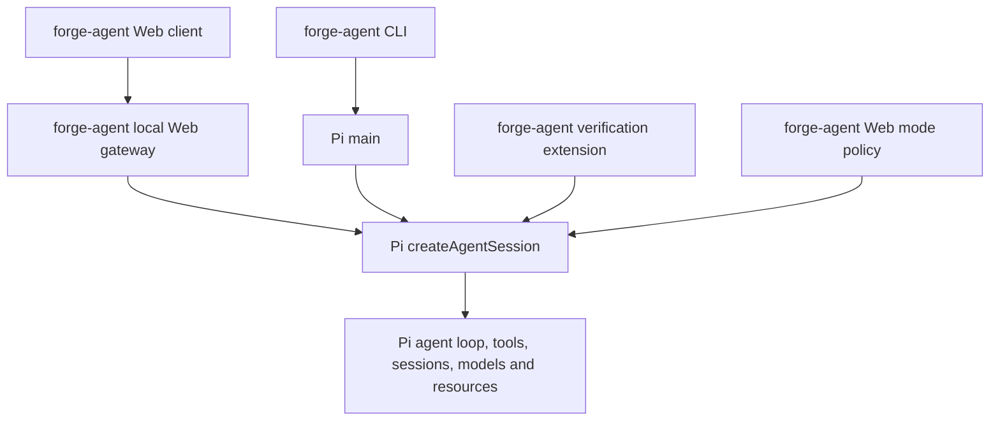

# Forge Agent architecture and current scope

Reviewed against the local implementation on 2026-11-06. The current package is
`forge-agent` 0.1.0 and pins Pi Coding Agent and Pi AI to 1.4.0.

forge-agent is a product layer built on the Pi Coding Agent SDK. It does not fork Pi
or implement a second agent loop. It uses more than Pi's model request runtime:
the coding-agent session, tools, history, settings, and resource discovery are
also supplied by Pi.

## Ownership

| Capability | Implementation |
| --- | --- |
| Agent reasoning/tool loop and automatic continuation | Pi `AgentSession`, created through `createAgentSession`; CLI delegates to Pi `main`. |
| Model calls, provider authentication, model catalog | Pi `ModelRuntime` and `pi-ai`; forge-agent adds the Web editor for compatible third-party providers. |
| Persistent conversation and compaction | Pi `SessionManager` and session APIs; forge-agent groups and renders history in the browser. |
| Settings and project trust | Pi `SettingsManager`, `ProjectTrustStore`, and resource loading APIs. |
| Tools, skills, context files, extensions, prompt templates | Pi's tools and `DefaultResourceLoader`, with the Web limitations below. |
| Web interface and streaming transport | forge-agent `src/web/` and `src/web/ui/`. |
| Workspace inspection and user attachments | forge-agent `src/web/files.ts`, the right-side workspace, and the shared bounded command executor: trusted project-file search/preview, bounded image/file attachments, and an explicit user-controlled terminal. |
| Agent / Plan / Ask | forge-agent policy registered as a Pi extension; Plan and Ask allow only built-in read/search tools. |
| Project verification and bounded repair attempts | forge-agent `src/config.ts`, `src/verification/pi-extension.ts`, `src/verification/verify.ts`, and `src/tools/command.ts`. |
| Local gateway authorization | forge-agent `src/web/auth.ts` and gateway checks; separate from Pi's provider credentials. |
| Web MCP management | forge-agent `src/web/mcp.ts`, `src/web/mcp-runtime.ts` and `src/web/ui/mcp.js`: scoped editing, probes, browser authorization, per-tool controls and session connection views. Pi owns validation, protocol, OAuth and execution. |
| Planned task orchestration | forge-agent `src/task/controller.ts`; Pi still executes every model/tool turn. |
| Home ownership and task index | forge-agent `src/task/registry.ts`; a `proper-lockfile` lease gives one Web gateway ownership of a Forge home, preserves an owner-free recovery path after a stale process, and surfaces index write diagnostics. |
| Project execution ownership | forge-agent `src/web/executions.ts` and `src/project-identity.ts`; Agent prompts, terminal commands, project-trust changes, and shutdown share one canonical-directory reservation. |
| Execution budgets | forge-agent `src/task/budget.ts` and Web hooks; each execution observes duration, model turns, tool calls, provider-reported tokens and cost, then aborts Pi and records `budget_exceeded`. |
| Git change evidence and bounded diff preview | forge-agent `src/task/git.ts` and the Web changes panel; pre-existing dirty files are marked. |

The CLI's TUI remains Pi's interface. The Web interface is forge-agent's own
implementation. Using the Pi SDK does not automatically expose every Pi CLI
feature in the browser.

Both entry points add a shared `forge_identity` prompt section and explicit Web
or terminal interface context through Pi's `before_agent_start` extension hook.
Greetings and capability introductions focus on Forge Agent and the current
interface; architecture questions retain accurate attribution to the Pi runtime.
A narrow `context_with_system` projection replaces only the pinned SDK's exact
default identity preamble, including when replaying older sessions. It preserves
custom system prompts, tool declarations, rules, project context, skills and mode
policies, and leaves the stored transcript unchanged. Repository descriptions and
earlier assistant introductions do not determine the current product interface.

## Product-owned task controller

Adaptive Agent execution is the default path. The Web composer also exposes
**规划并执行** behind a collapsed second-level control for explicit staged execution.
The selected workflow is persisted with the current Pi session; new conversations
always start adaptive and ignore legacy global workflow preferences. Web prompts
send the selected workflow explicitly; API prompts that omit it use `direct`, even
when the session previously selected `planned`. The product-owned controller coordinates:

`Inspect → Plan → Implement → Verify → Review → Complete`

Each phase is a Pi prompt or custom continuation, so tool calls and automatic
model recovery still belong to Pi. The controller owns phase transitions, a
bounded verification repair budget, cancellation, durable task entries in the
Pi branch, and the completion gate. A task cannot become complete from model
prose alone: configured verification must pass and the review response must be
structured and issue-free. Missing verification produces `needs_attention`.

The controller stores a versioned snapshot after phase changes, verification
evidence, and review. On process restart a running snapshot becomes
`interrupted`; the Web client shows **重新检查并继续**. It re-inspects the
current workspace and does not replay the previous prompt or side effects
automatically.

The budget runtime is attached to the host execution rather than to one phase.
It therefore covers planned inspection, implementation, verification repairs,
review, automatic Pi recovery, and explicit continuation within that execution.
The same runtime also guards adaptive prompts. Provider usage is observed when
Pi emits a completed assistant message, so the limits are protective host
guards rather than exact billing cutoffs. Changing the configured limits affects
the next execution; it does not rewrite an existing snapshot.

## Web integration limits

- Pi's CLI loads its built-in MCP, codemode, and tool-search extensions. The Web
  adapter now installs the same factories and preserves Pi's builtin,
  replaceable, disabled-extension, and project-trust semantics. The Web mode
  policy still blocks dynamically activated or nested MCP calls in Plan and Ask.
- Web settings expose MCP CRUD, global/project overlays, per-tool exposure, connection tests,
  browser OAuth and per-session status with reconnection.
  The control plane uses Pi's public extension registration API for validation and
  temporary Pi sessions for probes and authorization. A small adapter captures the built-in
  extension's public command/tool registrations, reads its RPC status, and preserves original
  tool names. It reloads idle sessions after configuration
  changes. See [MCP management](mcp-management.md) for lifecycle and credential rules.
- Skills and compatible extensions use Pi discovery. Terminal-specific custom
  extension UI cannot be rendered as an arbitrary browser component; the Web
  adapter reports that limitation.
- API-key setup is available in Web settings. Provider OAuth is still completed
  through Pi's TUI flow. The browser then uses the saved credential through Pi.
- Pi has additional history capabilities; the Web client exposes grouped history,
  search, reopening, renaming, pinning, archive/trash/restore, compaction, and
  message-level forks. Web history metadata is stored as Pi custom entries, while
  names use Pi session-info entries. A fork uses a disposable Pi session manager
  and `createBranchedSession()` so the live source session is never moved. Saved
  sessions can be exported as Markdown or structured JSON without changing the
  source branch. Background task management is not yet exposed as a separate
  queue; a running session continues in the local gateway while its browser tab
  is away.
- Verification reports are persisted as an atomic project latest record and a
  run-specific evidence file, and the corresponding outcome is also appended to
  the Pi session branch. The Web task panel displays the associated evidence.

- The right-side workspace has independent Git changes, project-file, and terminal
  views. Project files are checked again at reference time for path containment,
  symlinks, sensitive names, size, and text content. Images are validated by MIME,
  file header, and aggregate size before Pi receives them. The terminal is a
  separate explicit-user API, requires project trust, uses the shared bounded
  command executor. The terminal, Agent, trust changes, and service shutdown
  use the same project reservation, so aliases such as junctions cannot bypass
  the exclusion. Closing the service aborts an active terminal through the same
  signal and waits for the reservation to release.

For planned tasks forge-agent captures a Git baseline and later compares the current
status. The Web panel shows staged, unstaged, and untracked files, previews
bounded text diffs, refuses symlink escapes and sensitive credential files, and
marks files already dirty before the task. It reports Git, unborn-repository,
and non-Git limits instead of attributing every workspace change to the agent.

Current lifecycle limits matter when interpreting these controls: a Forge home is
intentionally single-owner, so a second gateway sharing it is rejected rather
than merged. There is no independent background queue; a running session remains
owned by the local gateway while its browser tab is away. Scoped memory is
user-maintained reference injection, not automatic learning or retrieval. Global
and project memory are stored under the Forge home, and project memory uses the
canonical real directory with validated legacy migration; Pi owns automatic
compaction.
The [product review](product-audit.md) records reproduced cases and acceptance criteria.

## Active and legacy code

The product entry points are `src/pi-cli.ts` and `src/web/server.ts`. Their
dependencies are emitted by TypeScript and Web assets are copied by
`scripts/build.mjs`. `vitest.config.ts` explicitly selects the active tests.

Earlier self-built agent, provider, context, MCP, security, storage, and eval
modules, tests and old demos are preserved under `archive/prototype/`. They are
excluded from the active product and must not be counted as implemented features
or passing active tests. The active task evaluation harness is
`scripts/evaluate-agent.mjs`; it uses the supported Web/Pi path.

## Release assessment

The current version is suitable for local development and early feedback. A
browser that opens and a passing mock-provider test suite do not establish
frontier coding performance or external provider compatibility.

The task controller, Git review, durable evidence/drafts and Pi MCP integration
have regression and browser coverage. The small scripted evaluation suite checks
the plumbing, not frontier coding quality. Real-model results on larger coding
tasks and broader provider compatibility remain necessary before generalizing.
See [evaluation](evaluation.md) and [the product audit](product-audit.md).
