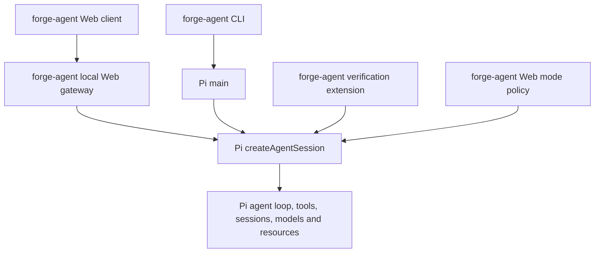

# Forge Agent architecture and current scope

Reviewed against the local implementation on 2026-11-03. The current package is
`forge-agent` 0.1.0 and pins Pi Coding Agent and Pi AI to 1.4.0.

forge-agent is a product layer built on the Pi Coding Agent SDK. It does not fork Pi
or implement a second agent loop. It uses more than Pi's model request runtime:
the coding-agent session, tools, history, settings, and resource discovery are
also supplied by Pi.

## Ownership

| Capability | Implementation |
| --- | --- |
| Agent reasoning/tool loop and automatic continuation | Pi `AgentSession`, created through `createAgentSession`; CLI delegates to Pi `main`. |
| Model calls, provider authentication, model catalog | Pi `ModelRuntime` and `pi-ai`; forge-agent adds the Web editor for compatible third-party providers. |
| Persistent conversation and compaction | Pi `SessionManager` and session APIs; forge-agent groups and renders history in the browser. |
| Settings and project trust | Pi `SettingsManager`, `ProjectTrustStore`, and resource loading APIs. |
| Tools, skills, context files, extensions, prompt templates | Pi's tools and `DefaultResourceLoader`, with the Web limitations below. |
| Web interface and streaming transport | forge-agent `src/web/` and `src/web/ui/`. |
| Agent / Plan / Ask | forge-agent policy registered as a Pi extension; Plan and Ask allow only built-in read/search tools. |
| Project verification and bounded repair attempts | forge-agent `src/config.ts`, `src/verification/pi-extension.ts`, `src/verification/verify.ts`, and `src/tools/command.ts`. |
| Local gateway authorization | forge-agent `src/web/auth.ts` and gateway checks; separate from Pi's provider credentials. |
| Planned task orchestration | forge-agent `src/task/controller.ts`; Pi still executes every model/tool turn. |
| Git change evidence and bounded diff preview | forge-agent `src/task/git.ts` and the Web changes panel; pre-existing dirty files are marked. |

The CLI's TUI remains Pi's interface. The Web interface is forge-agent's own
implementation. Using the Pi SDK does not automatically expose every Pi CLI
feature in the browser.

## Product-owned task controller

Direct conversation remains a low ceremony path. The Web composer also exposes
**计划并执行** for tasks where completion needs evidence. The product-owned
controller coordinates:

`Inspect → Plan → Implement → Verify → Review → Complete`

Each phase is a Pi prompt or custom continuation, so tool calls and automatic
model recovery still belong to Pi. The controller owns phase transitions, a
bounded verification repair budget, cancellation, durable task entries in the
Pi branch, and the completion gate. A task cannot become complete from model
prose alone: configured verification must pass and the review response must be
structured and issue-free. Missing verification produces `needs_attention`.

The controller stores a versioned snapshot after phase changes, verification
evidence, and review. On process restart a running snapshot becomes
`interrupted`; the Web client shows **重新检查并继续**. It re-inspects the
current workspace and does not replay the previous prompt or side effects
automatically.

## Web integration limits

- Pi's CLI loads its built-in MCP, codemode, and tool-search extensions. The Web
  adapter now installs the same factories and preserves Pi's builtin,
  replaceable, disabled-extension, and project-trust semantics. The Web mode
  policy still blocks dynamically activated or nested MCP calls in Plan and Ask.
- Skills and compatible extensions use Pi discovery. Terminal-specific custom
  extension UI cannot be rendered as an arbitrary browser component; the Web
  adapter reports that limitation.
- API-key setup is available in Web settings. Provider OAuth is still completed
  through Pi's TUI flow. The browser then uses the saved credential through Pi.
- Pi has additional history capabilities; the Web client currently exposes
  grouped history, search, reopening, renaming, and compaction. Archive, fork,
  export, and background task management are not yet exposed.
- Verification reports are persisted as an atomic project latest record and a
  run-specific evidence file, and the corresponding outcome is also appended to
  the Pi session branch. The Web task panel displays the associated evidence.

For planned tasks forge-agent captures a Git baseline and later compares the current
status. The Web panel shows staged, unstaged, and untracked files, previews
bounded text diffs, refuses symlink escapes and sensitive credential files, and
marks files already dirty before the task. It reports Git, unborn-repository,
and non-Git limits instead of attributing every workspace change to the agent.

## Active and legacy code

The product entry points are `src/pi-cli.ts` and `src/web/server.ts`. Their
dependencies are emitted by TypeScript and Web assets are copied by
`scripts/build.mjs`. `vitest.config.ts` explicitly selects the active tests.

Earlier self-built agent, provider, context, MCP, security, storage, and eval
modules, tests and old demos are preserved under `archive/prototype/`. They are
excluded from the active product and must not be counted as implemented features
or passing active tests. The active task evaluation harness is
`scripts/evaluate-agent.mjs`; it uses the supported Web/Pi path.

## Release assessment

The current version is suitable for local development and early feedback. A
browser that opens and a passing mock-provider test suite do not establish
frontier coding performance or external provider compatibility.

The task controller, Git review, durable evidence/drafts and Pi MCP integration
have regression and browser coverage. The small scripted evaluation suite checks
the plumbing, not frontier coding quality. Real-model results on larger coding
tasks and broader provider compatibility remain necessary before generalizing.
See [evaluation](evaluation.md) and [the product audit](product-audit.md).
