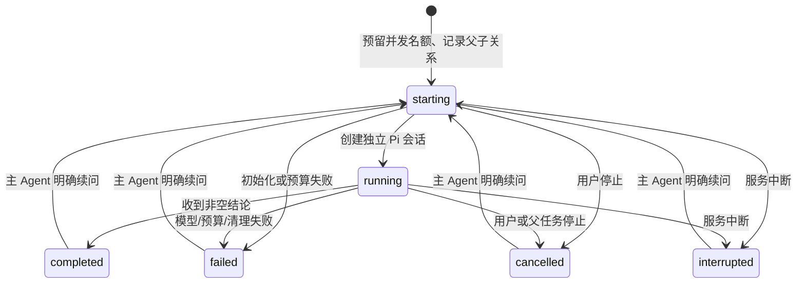

# 子 Agent 设计 / Subagent design

Forge 在 Web 父会话之上管理子任务；每个子任务仍由 Pi `createAgentSession` 执行。没有第二套模型循环，也没有把阶段切换或普通会话 fork 当成子 Agent。

## 使用与交互

主 Agent 按需调用 `subagent({ tasks: [...] })`。每项任务包含 `title`、`role`（`explorer` 或 `reviewer`）和完整 `prompt`；续问提供先前返回的 `id`。每批最多三个，调用等待整批完成，结果只含状态、用量、结论与错误，不把子 Agent 的完整工具输出和思考注入父上下文。父 Agent 必须判断证据并汇总，子结论不能代替 Forge 验证门禁。

会话标题旁的子任务入口只在有记录时出现。列表展示任务标题、角色、状态、token 和耗时；点击后在右侧打开子会话，工具输出、思考与任务说明默认折叠。可单独停止子任务；普通聊天历史不展示这些内部会话。用户需要对子任务续问时，可让主 Agent 继续该任务；当前右侧面板是记录查看与停止入口，不提供独立输入区。

交互参考了 DeepSeek Harness 的父会话目录、按需详情、独立停止和子会话历史分流。Forge 当前采用一层、受限只读批次，未实现 Harness 的后台通知、任意树层级、Team board 或外部 Agent 后端：

- [官方子 Agent UI 文档](https://github.com/deepseek-ai/deepseek-harness/blob/master/packages/client/ui-subagent/README.md)
- [官方子 Agent 生命周期文档](https://github.com/deepseek-ai/deepseek-harness/blob/master/packages/subagent/subagent/README.md)

## 状态、归属和恢复

父 Pi 会话保存版本化 `forge.subagent` 自定义条目，绑定其真实 session ID；子 Pi 会话保存在 `FORGE_AGENT_HOME/subagents/<parent-id>/<child-id>/`。详情和停止只能通过父会话目录中确有归属的 ID 寻址，客户端不能传会话文件路径。子会话读取还检查真实路径、session ID 和项目目录。普通用户 fork 得到新的父 ID，因此不能控制原分支的孩子。

重启时仅把进行中的状态恢复为 `interrupted`，不会重放模型请求。后续显式续问复用子会话历史和原模型/推理强度；模型不可用则返回失败，不静默替换。失败与取消不会伪造完成。

## 权限、并发与预算

- 仅允许已信任项目中正在运行且允许执行的父任务委派；Plan、Ask 和只读任务阶段不能用它扩大权限。
- 子会话只注册 Pi 内置 `read/grep/find/ls`，实际工具调用再次检查来源与白名单；不加载全局或项目可执行扩展、MCP、codemode、提示模板或技能，也不解析/安装资源包或发起缓存预热。读取工具仍具有启动者的文件读取权限，这不是 OS 沙箱。
- 最多三个活跃子任务，从初始化开始预留名额，等清理结束才释放；单次用户请求最多十二次激活，自动继续不会重置计数。
- 主任务继续持有现有规范化项目锁。子任务属于该次执行，只读并行；主任务是唯一写入者，终端和其他写入会话仍互斥。
- 子任务的模型回合、工具调用、token 和费用同时计入父预算，另有每次激活预算。父预算终止不能被某个孩子的取消回调覆盖。
- 父停止、关闭服务或执行收尾会停止并等待所有子任务。子任务资源清理失败会记为失败，不能以成功释放。

## 验证与边界

`tests/web-subagents.test.ts` 使用真实 Pi 会话和本机 OpenAI 兼容测试服务，覆盖独立上下文、并行、工具读取、续问、持久化、归属、写入拦截、禁用项目扩展、预算和取消。Web UI 测试检查入口、输出净化、默认折叠和会话切换；`scripts/check-web-ui.mjs` 用隔离 Edge 核对实际父子调用、列表、右侧详情、窄屏、单独停止及刷新恢复。

这些测试验证机制和交互，不能证明真实模型的多 Agent 编码质量高于单 Agent。当前不支持并行编辑、worktree 合并、子任务直接续聊、跨进程调度或 CLI 子任务界面。实现这些能力需要分别设计写入隔离、冲突回收、独立执行所有权及评测。

## English overview

Forge owns admission, a durable parent-owned catalog, capacity reservation, cancellation, aggregate budgets and result collection. Pi owns every child session and its model/tool loop. A synchronous batch of up to three read-only workers returns bounded conclusions; the parent can continue an owned child by ID. The UI uses a compact parent-header catalog and a separate details panel with Stop. Ordinary history omits internal children.

Ownership does not survive an ordinary conversation fork. Active records restore as interrupted without replay. Children inherit their original configured model and reasoning effort, have independent contexts, and cannot execute extensions, MCP, shell commands or writes. Parent cancellation waits for cleanup. These are application tool policies, not operating-system isolation. Parallel writers, direct child-panel messages, external backends and real-model quality claims remain outside the current implementation.
