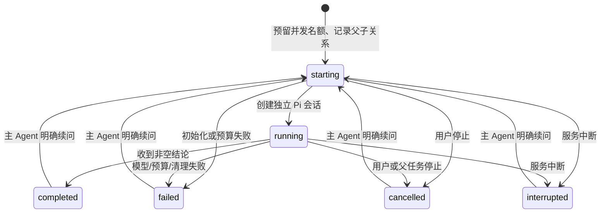

# 子 Agent 设计 / Subagent design

Forge 在 Web 父会话之上管理子任务；每个子任务仍由 Pi `createAgentSession` 执行。没有第二套模型循环，也没有把阶段切换或普通会话 fork 当成子 Agent。

## 使用与交互

主 Agent 按需调用 `subagent({ tasks: [...] })`。每项包含 `title`、`role`（`explorer`、`reviewer` 或 `worker`）和完整 `prompt`；只读子会话续问提供先前的 `id`，可写任务需新建委派。每批最多三个，调用等待整批完成，结果只含状态、用量、结论、proposal 标识与错误，不把完整工具输出和思考注入父上下文。父 Agent 必须判断证据并汇总，子结论不能代替 Forge 验证门禁。

会话标题旁的子任务入口只在有记录时出现。列表展示任务标题、角色、状态、token 和耗时；点击后在右侧打开子会话，工具输出、思考与任务说明默认折叠。可单独停止子任务；普通聊天历史不展示这些内部会话。用户需要对子任务续问时，可让主 Agent 继续该任务；当前右侧面板是记录查看与停止入口，不提供独立输入区。

交互参考了 DeepSeek Harness 的父会话目录、按需详情、独立停止和子会话历史分流。Forge 当前采用一层受限批次，未实现 Harness 的后台通知、任意树层级、Team board 或外部 Agent 后端：

- [官方子 Agent UI 文档](https://github.com/deepseek-ai/deepseek-harness/blob/master/packages/client/ui-subagent/README.md)
- [官方子 Agent 生命周期文档](https://github.com/deepseek-ai/deepseek-harness/blob/master/packages/subagent/subagent/README.md)

## 状态、归属和恢复

父 Pi 会话保存版本化 `forge.subagent` 自定义条目，绑定其真实 session ID；子 Pi 会话保存在 `FORGE_AGENT_HOME/subagents/<parent-id>/<child-id>/`。详情和停止只能通过父会话目录中确有归属的 ID 寻址，客户端不能传会话文件路径。子会话读取还检查真实路径、session ID 和项目目录。普通用户 fork 得到新的父 ID，因此不能控制原分支的孩子。

重启时仅把进行中的状态恢复为 `interrupted`，不会重放模型请求。只读子会话显式续问复用原历史、模型与强度；模型不可用则失败，不静默替换。可写子任务先审阅已有 proposal，再新建委派。失败与取消不会伪造完成。

## 权限、并发与预算

- 仅允许已信任项目中正在运行且允许执行的父任务委派；Plan、Ask 和只读任务阶段不能用它扩大权限。
- 探索和审阅只注册 Pi 内置 `read/grep/find/ls`；可写 worker 另有 `write/edit`。调用再次检查来源与白名单。不加载全局或项目可执行扩展、MCP、codemode、提示模板或技能，也不解析/安装资源包或缓存预热。读取工具仍具有启动者权限，这不是 OS 沙箱。
- 最多三个活跃子任务，从初始化开始预留名额，等清理结束才释放；单次用户请求最多十二次激活，自动继续不会重置计数。
- 主任务继续持有规范化项目锁。探索/审阅读取主目录；每个 worker 在 home 下独立 detached Git worktree 内写入。终端和其他主目录写入仍互斥。
- 子任务的模型回合、工具调用、token 和费用同时计入父预算，另有每次激活预算。父预算终止不能被某个孩子的取消回调覆盖。
- 父停止、关闭服务或执行收尾会停止并等待子任务。空闲 abort 或重复 dispose 的尽力清理错误不篡改已完成结果；变更封存失败会记为失败。

## 可写任务与应用

worker 需要有 HEAD 的 Git 仓库。以当前提交创建独立 worktree，再复制检查点可收集的当前文件内容，包括已有脏改动和删除。写入只允许该目录中的普通非敏感文件；链接、路径穿越、Pi 会展开的 `~`/`@`/file URL、Unicode 空格别名和 Windows 非规范路径会被拒绝。没有 shell、MCP 或继续委派权限。

收尾封存 before/after proposal，不自动改变主项目。右侧可以预览差异、选择文件并应用；父会话必须空闲、处于可信 Agent 模式，proposal 必须完成且归当前父会话。服务端重新校验 revision、HEAD 和所选主项目文件，拒绝后续修改冲突；应用建立主项目撤销检查点并保留 Git 暂存内容。子任务不能运行验证，应用后需由主任务执行项目检查。

用户可以清理已停止 worker 的目录，封存补丁与会话仍保留。没有自动三方合并；不同 worker 修改同一文件时，先应用的修改会让后续 proposal 报冲突。快照大小、未收集文件和中断日志限制见 [运行说明](operations.md)。

## 验证与边界

`tests/web-subagents.test.ts` 使用真实 Pi 会话和本机 OpenAI 兼容测试服务，覆盖独立上下文、并行、工具读取、续问、持久化、归属、写入拦截、禁用项目扩展、预算和取消。Web UI 测试检查入口、输出净化、默认折叠和会话切换；`scripts/check-web-ui.mjs` 用隔离 Edge 核对实际父子调用、列表、右侧详情、窄屏、单独停止及刷新恢复。

测试另覆盖 worktree seed、主项目保持不变、选择应用、冲突拒绝、清理和特殊路径拦截。这些验证机制和交互，不能证明真实模型的多 Agent 编码质量更高。当前不支持自动三方合并、子任务面板直接续聊、分布式调度或 CLI 子任务界面。

## English overview

Forge owns admission, a parent-owned catalog, capacity reservation, cancellation, aggregate budgets and result collection. Pi owns every child model/tool loop. A synchronous batch of up to three children can explore/review with readers or edit in detached worktrees. Read-only children support follow-ups; writers require new delegation. The compact header catalog opens a separate details/review panel. Ordinary history omits internal children.

Ownership does not survive an ordinary fork. Active records restore as interrupted without replay. Children inherit model/effort, have independent contexts, and cannot execute extensions, MCP or shell commands. Writers produce sealed proposals for explicit selected-file application; stale revisions and main-project conflicts are refused, application creates undo evidence, and the parent must verify afterward. Worktree cleanup retains proposals/transcripts. Parent cancellation waits for cleanup. These are application tool policies, not OS isolation. Automatic merge, direct child-panel messages, separate child models, external backends and measured quality gains remain outside the implementation.
