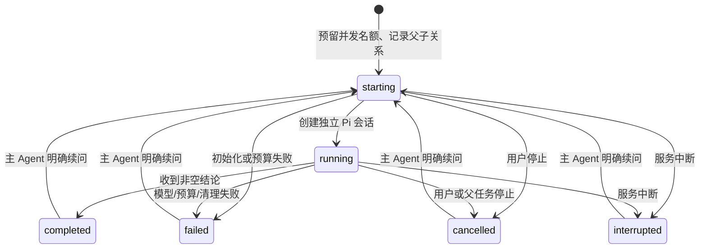

# 子 Agent 设计 / Subagent design

Forge 在 Web 父会话之上管理子任务；每个子任务仍由 Pi `createAgentSession` 执行。没有第二套模型循环，也没有把阶段切换或普通会话 fork 当成子 Agent。

## 使用与交互

主 Agent 可调用 `subagent({ action: "start", tasks: [...] })` 异步启动，立即获得句柄并继续独立工作；`status` 查询，`wait` 等待最多 30 秒，`result` 取回结果。省略 action 的调用保留整批等待行为。每项包含 `title`、`role`（`explorer`、`reviewer` 或 `worker`）和完整 `prompt`，也可以附带结构化 `scope`：`files`、`deliverables`、`acceptance`、`dependencies`。这组字段是父子交接和结果核对的任务上下文，不改变工具权限；子任务续问不能偷偷替换它。只读续问提供先前 `id`，可写任务需新建委派。每批最多三个，结果只含状态、用量、结论、proposal 标识与错误，并要求明确完成项、未验证项和需要父任务处理的事项。Pi 的 `agent_before_settle` 在父任务结束前等待未取回结果并触发汇总；宿主再检查结果已取回，保存失败或仍有未汇总结果不能完成。父 Agent 必须判断证据，子结论不能代替验证门禁。

规划并执行的最后审阅是宿主专用的 `reviewGate`，不是模型通过 `subagent` 工具自行申请的普通 reviewer。它每次启动全新的只读子会话，只接收原始请求的有界摘要、完整 `TaskBrief`、requirements 账本、计划、验证结果和实际文本补丁；不接收父会话 transcript，也不接受语义续问。若 JSON 第一次不符合 schema，宿主在同一 reviewer 会话中发送一次格式校正，仍使用同一预算；再次失败就需要人工处理。宿主保存审阅子会话 ID 与模型，并要求其只返回结构化审阅 JSON，覆盖每个验收 ID，不套用普通子任务的分节结论格式。独立审阅增加了一个可测量的模型调用，仍不能替代外部验证或证明代码正确。审阅收到的命令回执带有测试/普通命令、通过/失败/零测试/未知等启发式分类和汇总，但明确标为历史观察；分类不会把回执升级成当前版本的验证。模型计划中的自动检查和建议证据不是主机回执；缺少精确 reproduction 回执本身只是证据限制，reviewer 必须结合补丁、聚焦代码和已有检查判断，只有用户明确要求执行该检查时才可仅因缺少该回执阻断。

会话标题旁的子任务入口只在有记录时出现。列表展示任务标题、角色、状态、token 和耗时；点击后在右侧打开子会话，工具输出、思考与任务说明默认折叠。可单独停止子任务；普通聊天历史不展示这些内部会话。用户需要对子任务续问时，可让主 Agent 继续该任务；当前右侧面板是记录查看与停止入口，不提供独立输入区。

交互参考了 DeepSeek Harness 的父会话目录、按需详情、独立停止和子会话历史分流。Forge 支持一层受限异步委派与结果回收；任意树层级、Team board 和外部 Agent 后端仍未实现：

- [官方子 Agent UI 文档](https://github.com/deepseek-ai/deepseek-harness/blob/master/packages/client/ui-subagent/README.md)
- [官方子 Agent 生命周期文档](https://github.com/deepseek-ai/deepseek-harness/blob/master/packages/subagent/subagent/README.md)

独立审阅只有未确认验收项、没有具体问题时，宿主可在父 Pi 会话补证一次，随后重新验证并创建全新 reviewer。补证与验证失败、代码缺陷修复共用 `verifyRetries`，并单独持久化 `reviewEvidenceRepairs`（0 或 1）；继续和重启不重置。缺失/重复/未知验收 ID、`unmet` 或无效审阅不能触发这条补证路径。补证也不增加子 Agent 的 shell、写入或网络权限。

## 状态、归属和恢复

父 Pi 会话保存版本化 `forge.subagent` 自定义条目，绑定其真实 session ID；子 Pi 会话保存在 `FORGE_AGENT_HOME/subagents/<parent-id>/<child-id>/`。详情和停止只能通过父会话目录中确有归属的 ID 寻址，客户端不能传会话文件路径。子会话读取还检查真实路径、session ID 和项目目录。普通用户 fork 得到新的父 ID，因此不能控制原分支的孩子。

重启时仅把进行中的状态恢复为 `interrupted`，不会重放模型请求。只读子会话显式续问复用原历史、模型与强度；模型不可用则失败，不静默替换。可写子任务先审阅已有 proposal，再新建委派。失败与取消不会伪造完成。

## 权限、并发与预算

- 仅允许已信任项目中正在运行且允许执行的父任务委派；Plan、Ask 和只读任务阶段不能用它扩大权限。
- 探索和审阅只注册 Pi 内置 `read/grep/find/ls`；可写 worker 另有 `write/edit`。调用再次检查来源与白名单。不加载全局或项目可执行扩展、MCP、codemode、提示模板或技能，也不解析/安装资源包或缓存预热。读取工具仍具有启动者权限，这不是 OS 沙箱。
- 最多三个普通活跃子任务，从初始化开始预留名额，等清理结束才释放；单次用户请求最多十二次普通激活，自动继续不会重置计数。交付审阅由宿主单独计数，但同样受并发、父预算和每次门禁预算约束。
- 主任务继续持有规范化项目锁。探索/审阅读取主目录；每个 worker 在 home 下独立 detached Git worktree 内写入。终端和其他主目录写入仍互斥。
- 子任务的模型回合、工具调用、token 和费用同时计入父预算，另有每次激活预算；普通子任务上限为 3 分钟/12 回合/60 工具/16,000 生成 token/$2，reviewGate 默认 5 分钟/24 回合/120 工具/32,000 生成 token/$4；设置中可显式选择扩展档 8 分钟/40 回合/160 工具/48,000 生成 token/$6。父预算、取消信号和费用上限优先，reviewGate 不会把总任务预算扩大；审阅自身达到上限会以可识别的 `needs_attention` 原因结束，不伪装成代码失败或成功。
- 父停止、关闭服务或执行收尾会停止并等待子任务。空闲 abort 或重复 dispose 的尽力清理错误不篡改已完成结果；变更封存失败会记为失败。

## 可写任务与应用

worker 需要有 HEAD 的 Git 仓库。以当前提交创建独立 worktree，再复制检查点可收集的当前文件内容，包括已有脏改动和删除。写入只允许该目录中的普通非敏感文件；链接、路径穿越、Pi 会展开的 `~`/`@`/file URL、Unicode 空格别名和 Windows 非规范路径会被拒绝。没有 shell、MCP 或继续委派权限。

收尾封存 before/after proposal，不自动改变主项目。右侧可以预览差异，选择“应用所选变更”或“应用并验证”；父会话必须空闲、处于可信 Agent 模式，proposal 必须完成且归当前父会话。服务端重新校验 revision、HEAD 和所选文件，拒绝后续修改冲突；应用建立撤销检查点并保留暂存内容。“应用并验证”在同一项目占用下交接给验证任务，只运行已配置的主项目命令，不发送模型请求；缺少验证配置会在写入前拒绝。失败保留已应用内容和原始输出，不伪造成功，也不自动撤销。子任务本身仍没有命令执行权限。

用户可以清理已停止 worker 的目录，封存补丁与会话仍保留。没有自动三方合并；不同 worker 修改同一文件时，先应用的修改会让后续 proposal 报冲突。快照大小、未收集文件和中断日志限制见 [运行说明](operations.md)。

## 验证与边界

`tests/web-subagents.test.ts` 使用真实 Pi 会话和本机 OpenAI 兼容测试服务，覆盖独立上下文、并行、工具读取、续问、持久化、归属、写入拦截、禁用项目扩展、预算和取消。Web UI 测试检查入口、输出净化、默认折叠和会话切换；`scripts/check-web-ui.mjs` 用隔离 Edge 核对实际父子调用、列表、右侧详情、窄屏、单独停止及刷新恢复。

测试另覆盖 worktree seed、主项目保持不变、选择应用、冲突拒绝、清理和特殊路径拦截。这些验证机制和交互，不能证明真实模型的多 Agent 编码质量更高。当前不支持自动三方合并、子任务面板直接续聊、分布式调度或 CLI 子任务界面。

## English overview

Forge owns admission, a parent-owned catalog, capacity reservation, cancellation, aggregate budgets and result collection. Pi owns every child model/tool loop. `action=start` returns handles immediately; `status`, bounded `wait` and `result` manage retrieval. Pi's settlement boundary returns unread results for synthesis, and a host completion guard fails closed if collection fails. Omitting action retains blocking batches. Up to three children can explore/review with readers or edit detached worktrees. Read-only children support follow-ups; writers require new delegation. The compact catalog opens a separate details/review panel. Ordinary history omits internal children.

Ownership does not survive an ordinary fork. Active records restore as interrupted without replay. Children inherit model/effort, have independent contexts, and cannot execute extensions, MCP or shell commands. Writers produce sealed proposals for explicit selected-file application; stale revisions and main-project conflicts are refused and application creates undo evidence. The user can apply only, or apply and run configured parent-project verification under the same project lease without another model request. Missing checks are rejected before writing; failed checks retain applied content and original output. Worktree cleanup retains proposals/transcripts. Parent cancellation waits for cleanup. These are application tool policies, not OS isolation. Automatic merge, direct child-panel messages, separate child models, external backends and measured quality gains remain outside the implementation.

See [review outcomes / 审阅结果](review-outcomes.md) for structured stop reasons, recovery actions, legacy records, budget opt-in and missed-defect evidence boundaries.
