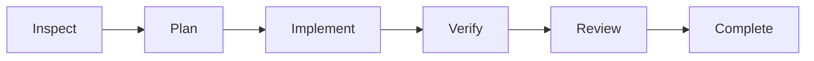

# Forge Agent user guide

[简体中文](usage.md) · [Project overview](../README.en.md)

See [Quick start](../README.en.md#quick-start) for installation and setup, and [Configure verification](../README.en.md#configure-verification) for project checks. This guide covers interface behavior, commands, integrations, and local data.

## Working modes and workflows

The working mode controls which tools may run:

| Mode | Purpose | Available tools |
| --- | --- | --- |
| **Agent** | Implement changes, run commands, and verify the project | Tools enabled by Pi configuration and project trust |
| **Plan** | Read the project and propose an implementation plan | Built-in read/search tools only |
| **Ask** | Understand code, explain behavior, and answer questions | Built-in read/search tools only |

Plan and Ask enforce restrictions on actual tool calls, blocking shell, writes, MCP/custom tools, extension/skill/template command dispatch, and automatic verification. Local interface commands for viewing context, choosing models, and opening settings remain available. Modes persist with the session and cannot change during a run. These policies restrict model-driven operations; trusted extension code still has the launching user's permissions.

Agent mode offers two workflows:

- **Adaptive execution (default)** (`自适应`): use Pi's interaction loop for everyday questions and changes, letting the model choose its steps, with configured verification.
- **Plan and execute (opt-in)** (`规划并执行`): a Forge Agent controller advances through the stages below, while Pi executes every model and tool turn.

The toolbar normally shows just **Agent**. Its workflow options sit behind a small arrow that stays collapsed until opened; a small planning badge appears only after opting in. The selection persists within the current session, including history recovery, while every new conversation starts adaptive. Web prompts explicitly include the selected workflow; API prompts that omit `workflow` default to adaptive. Planned prompts first produce structured task understanding through read-only inspection, then select implementation, answering, verification or clarification; regex hints are telemetry only. Explicit host verification actions invoke the gate directly.



Inspection preserves structured goals, constraints, relevant files, unresolved questions and host-assigned acceptance IDs. Unknown phrasing requires read-only understanding or clarification; research alone cannot silently satisfy an implementation request. Planning retains those requirements. Invalid handoffs stop before implementation, and model understanding never grants tool permissions or trust.

The planned workflow requires passing configured verification, current workspace evidence, unchanged protected paths, and a structured `ready` review with exact evidence-backed coverage of every acceptance ID. Missing, duplicated or unconfirmed findings cannot certify completion. Blocking defects belong in `issues`; optional observations belong in `notes`. Verification failures and concrete review defects share `verifyRetries`. Every repair reruns verification and review. Malformed review JSON gets one correction in the same independent Pi reviewer session and parent budget. A second invalid response needs attention; correction neither replays implementation nor resets the repair allowance.

The reviewer receives actual staged, unstaged and untracked text patches, marked when they include pre-existing user work. Limits are 2,000 lines per file and 60,000 patch characters in total. Oversized, binary, sensitive, truncated or HEAD-changing evidence requires manual inspection. Use a Git repository root for complete review evidence. Patches remain in the reviewer's local Pi transcript instead of being copied into every task-counter snapshot.

### Protect tests, lockfiles or other project paths

Configure the project's `forge-agent.json`, for example:

```json
{
  "verify": [{ "name": "test", "command": "npm test" }],
  "verifyRetries": 2,
  "protect": ["tests", "package-lock.json"]
}
```

`protect` accepts literal relative files and directories, without globs, absolute paths, parent traversal, links or `.git` metadata. Directory traversal includes ignored regular files. Content is fingerprinted before model execution; automatic repairs retain that baseline. Existing user edits are allowed but must stay unchanged, and missing protected paths must stay absent. Changed protected content fails delivery even when commands pass, returns path-level findings to the model, and affects both Web completion and the CLI exit code. Restoring the initial bytes requires fresh verification.

Limits are 200 configured paths, 20,000 observed entries, 256 MiB and 20 seconds per observation. Unreadable or oversized observations fail closed. This is a host delivery check, not an OS sandbox or prevention of tool side effects; temporary changes fully reverted between observations are outside its attestation. Protection also runs without configured checks, but does not imply automated verification passed.

Select **Execution history** (`执行记录`) beside progress, or the right workspace's **Execution** (`执行`) tab, to inspect acceptance, review, phases, model tokens, tool results, checks and repeated implementation attempts. Phases collapse to keep the main conversation clear. Tool timing is estimated from message intervals and includes waiting; missing results remain interrupted/running. History can be regenerated after reopening and offers no side-effect replay. See the [execution record protocol](execution-records.md).

Model stages finishing is followed by checkpoint sealing, mode restoration and persistence confirmation. Success remains pending until these finish. Finalization failures make the task fail while retaining historical passing checks. Sessions, task discovery, queues and recovery share the final result; permanent storage failure is explicit and cannot guarantee that its failure record reached disk.

Adaptive execution does not automatically add a model review. The client displays execution, verification, and review separately. Reports are bound to the command configuration and a workspace content fingerprint. Undo, worker-proposal application, and project terminal commands invalidate old evidence immediately, including partially failed operations. Opening sessions/tasks, reconnecting, and restoring after restart recheck external edits; idle queries may reuse an observation for at most 1.5 seconds. Original output remains historical evidence.

Git observations cover tracked and non-ignored untracked files, HEAD, and index content; non-Git observations cover ordinary files. Credentials, `node_modules`, and Forge local state are excluded. Observations are bounded to 20,000 entries, 256 MiB and 20 seconds. Links, nested repositories, unreadable or oversized content leave the version unconfirmed. Changes during verification also prevent a current-version claim; generated outputs should be ignored correctly. This is bounded content observation, not an atomic filesystem snapshot, environment attestation, or OS sandbox.

Stopping a task prevents later stages. After a service restart, unfinished work is marked interrupted and requires explicit continuation. Both the composer and task center preserve the original task workflow, regardless of the preference for the next message: adaptive tasks continue through Pi directly; planned tasks retain the goal, constraints and plan and resume the saved phase; interrupted verify/review starts with fresh verification. Legacy checkpoints without a usable handoff return to inspection. Protection baselines and consumed repair counts survive continuation. Continuation uses a hidden host message in the existing Pi conversation and workspace, so it does not append the original user request again or replay previous tool calls. Independent model review can still miss defects.

Model and reasoning changes remain available while a run is active. They are staged locally and applied immediately before the next message, so the current turn keeps its configuration. Project, working mode, workflow, settings, and new-chat actions are locked during execution. Thinking, tool calls, and phase output are grouped under a collapsed **Execution process** section while the final answer remains prominent. Press `Enter` to send and `Shift+Enter` for a newline.

The single-response output limit differs from the whole-task budget. On `length` (including reasoning-only responses) or empty output, the Web host asks Pi for at most two continuations using the same model, effort and budget. Repeated failure stops the current phase with the actual cause before verification. Continuing legacy records wrongly advanced to verify returns to incomplete implementation. Recovery prompts favor a minimal working file and bounded edits.

### Execution budgets and project ownership

Open **Settings → About → Execution budget** to set duration, model-turn, tool-call, generated-token, cumulative-request-token, and cost limits. New installations default to 90 minutes, 240 model turns, 500 tool calls, a 300,000 generated-token cap, a disabled cumulative-request-token guard (`0`), and 40 USD. Existing saved limits are preserved. The four-hour long-task preset fills 400 turns, 800 tools and 500,000 generated tokens while keeping the cost ceiling; it takes effect after saving. Adaptive and planned execution share the current segment's budget across inspection, verification repairs and the independent delivery review. Reaching a limit marks the task **budget exceeded**, aborts Pi, and leaves a resumable task. Continue reuses the current Pi conversation and workspace without sending the original request again, then starts a new bounded segment; adjusting settings is also supported.

Cumulative request tokens, when enabled with a value above zero, include repeated context and cache reads; they are distinct from current context-window occupancy beneath the composer. Execution details separate fresh input, output, cache reads, and cache writes, including in-flight usage arriving after cancellation. The default hard token guard is generated output. Missing model pricing is shown as unknown, or as a known subtotal with an unknown component. It does not mean free usage or a guaranteed billing cap.

Provider token and cost usage is usually reported at the end of a response, so this is a host protection threshold and one response may slightly cross it. It is not a billing-level isolation boundary. The budget is stored in `FORGE_AGENT_HOME/web-settings.json`, outside the strict project `forge-agent.json` schema.

Only one Web service may own a given `FORGE_AGENT_HOME` at a time. After an abnormal exit, the lease can be recovered after its stale interval; a second instance reports the existing local address. Agent execution, terminal commands, trust changes and reviewed filesystem operations share project ownership. Junctions, symlinks and Windows case aliases use canonical identity. Shutdown cancels active terminal work and waits for release. A detached service and durable queue support subsequent jobs; interrupted executions require explicit retry.

## Projects, sessions, and attachments

Use the `…` menu beside a project to remove it from the sidebar. Source files and Pi session files stay in place. Removal persists across refreshes and service restarts; explicitly opening the same folder restores the project and its history. Stop running work before removing its project.

Drag the small grip at the top of the composer up or down to adjust its height. The preferred height is remembered in this browser, within the available screen space. Double-click the grip to restore the default; when focused, use the arrow keys to adjust or Home/End for the minimum/maximum. Typing and clearing text preserve the chosen height.

The Web client does not preselect the directory from which the service was launched. You can type a first message immediately; once a model is available, Forge creates an independent project under `FORGE_AGENT_HOME/projects` using the message title and binds the conversation to it. The project picker also supports explicitly creating a Forge-managed project, opening another local folder, or returning to “create on send.” External folders stay where they are; Forge stores only their canonical path. All Pi sessions remain centralized under `FORGE_AGENT_HOME/sessions`, so projects, conversations, and forks can be managed together.

The paperclip next to Send supports selecting multiple images and files; drag and drop and pasted images also work. Images support PNG, JPEG, WEBP, and GIF; local files support UTF-8 text and source files, which are sent inline as user material and are not written into the project automatically. Project file references require a selected project. Credential files, symlinks, binary files, and oversized content are rejected. Uploaded content is marked as user material and cannot grant tool permissions or change project policy.

## Subtasks

For a complex request, ask Forge to explore modules in parallel, review risks or propose an implementation in an independent worktree. The parent may also delegate when useful. A delegation can include file scope, expected deliverables, acceptance criteria, and dependencies so the parent can judge the result; these fields do not grant extra permissions. Children use independent Pi contexts with the model/effort at delegation. Exploration/review use readers; implementation workers additionally edit ordinary files in their own worktrees. Shell is unavailable.

When children exist, a compact people icon appears beside the conversation header. Open its catalog for task titles, state, duration and tokens; select a row to view the child on the right. Task instructions, thinking and tool output start collapsed. **Stop subtask** stops just that child; the main composer Stop action cancels the parent and drains all children. Ask the parent to continue a previous subtask when you need a follow-up; direct messages from the details panel are not yet supported.

Children stay out of ordinary history. Refresh restores records; interruptions do not replay work. Parent and child budgets both apply. Writers use separate worktrees and produce selectively applied proposals; conflicts are not auto-merged. Writable tasks require new delegation rather than continuation in the old worktree.

## Composer commands and context

Type `/` in the composer or select **Commands** (`命令`) below it to search for an action. Use `↑` / `↓` to select, `Enter` to execute, `Tab` to complete, and `Esc` to close.

| Command | Purpose |
| --- | --- |
| `/new`, `/rename` | Start a conversation or rename the current one |
| `/model`, `/mode` | Open model/reasoning selection or working-mode selection |
| `/context` | Inspect the current context estimate, capacity, cumulative usage, and automatic compaction status |
| `/compact [instructions]` | Compact earlier content, optionally specifying what the summary should retain |
| `/changes` | Open the Git changes panel on the right |
| `/mcp`, `/settings`, `/help` | Open MCP settings, general settings, or command and keyboard help |

The menu separates actions, skills, and templates; extensions appear when loaded. Chinese titles distinguish model selection (`/model`) from working modes (`/mode`), and a fully typed command shows only its exact match. Select the **Skills** (`技能`) category to load the current project's skill list. Choosing a skill fills `/skill:name` into the composer so you can add the task before sending. Browsing and selecting skills do not request a model; Pi handles execution. The model can also read suitable skills on demand. Unavailable actions explain why, and unknown commands stay in the composer for editing. Model and reasoning changes selected during a run still apply to the next message.

Context usage and **Compact** (`压缩`) stay below the composer. Open the context details for cumulative input/output, cache usage, catalog-estimated cost, and compaction count; cumulative usage is shown separately from current window usage. Manual compaction calls the current model, requires an idle session, and can be cancelled. Conversation history is retained. After compaction, the old usage estimate is hidden until the next model response updates it.

Open **Settings → Memory** (`设置 → 记忆`) to maintain three layers of reference material: global memory is reused across projects, project memory is injected only for the current folder, and session memory is stored in the Pi session tree and retained by forks. Each item can be marked as a fact, preference, decision, or constraint and can be disabled independently. Memory is injected as user reference material and never grants tool permissions. The page also shows Pi's automatic compaction switch, `reserveTokens`, `keepRecentTokens`, and the number of compactions in the current session.

## Manage skills

Open **Settings → Skills** (`设置 → 技能`), or select **Manage skills** from the command menu's Skills category. Search by name, description, or source; filter by global/project scope; inspect instructions and diagnostics. Automatic invocation, manual-only skills, disabled skills, and name collisions have distinct statuses.

Expand **Add local skills** to reference a directory containing `SKILL.md` or an existing Markdown skill file. Choose global or project scope. Removing an imported reference preserves local files; switches disable resources in automatically discovered directories. Project resources still require project trust. Saving or refreshing reloads idle sessions and updates their `/` menus without restarting the service.

Discovery, name precedence, filtering, and persistence use Pi's native mechanisms. Browsing and previewing do not call a model, load project extensions, or install missing packages for the management view.

## Connect MCP services

Open **Settings → MCP → Add** (`设置 → MCP → 添加`). Choose local STDIO or Streamable HTTP, then enter a command and arguments, or a URL and headers. You can also expand **Import from JSON** (`从 JSON 导入配置`), paste another client's `mcpServers` configuration, and choose one service to fill the form. Enter one command argument per line; keep a path containing spaces on the same line.

Choose **Test current configuration** (`测试当前配置`), inspect the connection result and available tool catalog, then save. If an HTTP service reports that OAuth is required, choose **Sign In** (`登录授权`) after saving and approve access in the browser. The callback completes automatically. If popups are blocked, use the authorization link. Pasted redirects, cancellation, and removing local authorization are also supported. MCP authorization and model-provider sign-in are managed separately.

- **Global and project scope:** global configuration lives at `FORGE_AGENT_HOME/mcp.json`; project configuration lives at `<project>/.pi/mcp.json` and loads only after project trust. A same-name project entry can replace a global service, or override only its enabled state and tool exposure. A partial override does not copy global credentials into the project.
- **Connection tests:** a temporary Pi session opens a real connection and reports the latest result and discovered tools. It does not request a model or call tools. Testing starts the service process and closes the connection afterward. Results do not describe every chat session's live connection state.
- **Applying changes:** saving, toggling, or deleting reloads affected idle sessions through Pi. Stop active tasks before changing configuration. Existing working-mode restrictions remain in force.
- **Tool Settings:** configure individual tools, add wildcard rules, or restore inheritance. Existing `toolExposure` rules are preserved. Exact names take precedence over wildcard rules; the first matching wildcard rule wins. Plan and Ask continue to block MCP tool execution.
- **Session connections:** inspect the services actually loaded in each conversation in the current project. Status and tool counts refresh every three seconds; idle sessions can reconnect.
- **Credentials and editing:** saved environment values, header values, and OAuth client secrets are not returned to the editor. Leave them blank to retain existing values; remove a row or select secret removal to clear them. Concurrent edits are checked for conflicts. Authorization completion and status refresh preserve open editor drafts.

Open **Tool Settings** (`工具设置`) on a service card to choose how its tools are made available:

| Mode | Behavior and use case |
| --- | --- |
| **Codemode** (default) | The agent discovers and combines tools in scripts, useful when calls or results need composition and filtering. |
| **Deferred** | Tools are loaded through search when needed, useful for services with many tools. |
| **Direct** | Tools are declared directly to the model and remain callable from scripts, useful for a small set of frequently used tools. |
| **Hidden** | Tools are hidden and cannot be called. |

Pi owns MCP protocol, transports, tool discovery, execution, and OAuth. Browser authorization refreshes idle sessions; running sessions refresh after their current task ends. Put credentials in environment, header, or OAuth secret fields rather than command arguments or URLs. Changing a connection target requires re-entering credentials you want to retain. External vendors' OAuth metadata, registration policies, and proxy environments still need compatibility checks with those services. See the [MCP management design](mcp-management.md) for implementation details.

## Review memory, changes and child tasks

Model suggestions made with `memory_proposal` appear in **Settings → Memory → Pending memory**. Candidates do not enter context until accepted. Review content and source evidence, then accept or reject; duplicates and explicit replacements are visible, and concurrent edits require renewed review. Evidence is model-provided, not external verification. Existing memory remains editable, disableable and removable. Task-based lexical recall prioritizes constraints/preferences; expand the recall details to inspect selected items and reasons. Pi retains compaction ownership, with the goal and host task checkpoint preserved in the prompt.

Open **Changes → Execution checkpoints** in the right panel to select an Agent execution, preview files and undo selected changes. Only trusted Git roots support snapshots; ignored, known sensitive, linked and oversized files are excluded. Recovery preserves pre-execution dirty work without resetting Git. Changed HEAD/index, later edits and stale revisions block recovery. Interrupted multi-file recovery requires inspection; snapshots are not backups.

Implementation children use independent worktrees; exploration and review remain read-only. Inspect proposal diffs and select files to apply, or choose **Apply and verify** to run configured main-project checks without another model request. Missing checks are reported before application; failed checks preserve changes and output. Conflicts are not auto-merged. Cleanup retains sealed proposals. Children cannot use shell, MCP or further delegation. See [subagent design](subagents.md).

## Background operation and queue

After the first turn has persisted, add tasks in the task center or use `/queue task text`. The queue runs up to three different projects concurrently and serializes each project/session; busy projects do not block others. The task center shows counts and waiting reasons, and can independently stop running jobs or cancel queued ones. Explicit retry creates a new execution that inspects current state. Model, effort and workflow are frozen; composer attachments are not copied. Public state reflects successful disk commits. See [task scheduling](task-scheduling.md).

Closing the foreground `npm start` process ends execution. For detached operation, stop it first and run `node dist/pi-cli.js service start`; use `service status` and `service stop` for control. Queued jobs survive restarts, while started jobs become interrupted without replay. See [operations, storage and upgrades](operations.md).

## Optional command-line entry points

Run `npm link` once from the source directory if you want the command on your PATH:

```bash
forge-agent web                            # Start the Web client
forge-agent                                # Pi's interactive terminal interface
forge-agent doctor                         # Inspect local setup without printing credentials
forge-agent check                          # Run the current project's configured checks
forge-agent -C path/to/project -p "Fix the failing tests"
```

The Web API-key editor covers common compatible services, and MCP has a dedicated settings entry. Provider OAuth still uses `/login` in the terminal interface. Pi manages advanced skill and extension configuration; the Web client uses the same local configuration.

Sessions are stored under `FORGE_AGENT_HOME/sessions`. The sidebar groups them by project, and menu actions persist through Pi session metadata. Archive and trash change the Web presentation state while retaining the original session file for recovery. A fork creates a new Pi session file and records its origin; it does not send a model request automatically. Editing a user-message fork places the text back in the composer.

## Local data and security

| Data | Default location |
| --- | --- |
| Configuration, models, and authentication | `~/.forge-agent`, overridden by `FORGE_AGENT_HOME` |
| Forge-managed projects | `FORGE_AGENT_HOME/projects` |
| Project index | `FORGE_AGENT_HOME/web/projects.json` |
| Global MCP configuration and OAuth credentials | `FORGE_AGENT_HOME/mcp.json` and `FORGE_AGENT_HOME/mcp-auth.json` |
| Project MCP configuration | `<project>/.pi/mcp.json`, loaded only after project trust |
| Sessions | `FORGE_AGENT_HOME/sessions` |
| Global and project memory | `FORGE_AGENT_HOME/memory`; project files use canonical real-directory identity and legacy files migrate only after scope validation; session memory is stored in the Pi session tree |
| Web settings, execution budgets, and task index | `FORGE_AGENT_HOME/web-settings.json`, `FORGE_AGENT_HOME/tasks` |
| Verification evidence and raw output | `FORGE_AGENT_HOME/verification` |
| Queue, checkpoints and writable child directories | `FORGE_AGENT_HOME/tasks/queue.json`, `checkpoints/`, `worktrees/` |
| Local gateway access credential | `FORGE_AGENT_HOME/web/access-token` |

Legacy `PFORGE_HOME`, `~/.pforge`, and `pforge.json/yaml/yml` remain compatible. New `forge-agent.*` configuration takes precedence in the same directory. Existing sessions retain compatible storage identifiers.

The Web gateway binds to `127.0.0.1` by default, uses a local access credential and an HttpOnly, SameSite=Strict cookie, and checks Host and Origin. Model API keys are stored through Pi's authentication API; the editor does not return them or store them in browser storage.

Local operation describes where the client, process, and data live. With a remote model, relevant content is still sent to your configured provider. Agent tools, trusted extensions, and verification commands have the launching user's OS permissions. Project trust is not an OS sandbox; use a container, VM, or restricted account for untrusted projects. Sessions and raw logs can contain sensitive data, so inspect them before sharing. See [security notes](../SECURITY.md).

Task progress starts collapsed as one row. The stop reason stays beside the composer; expand progress for steps and usage or open execution history on the right.
